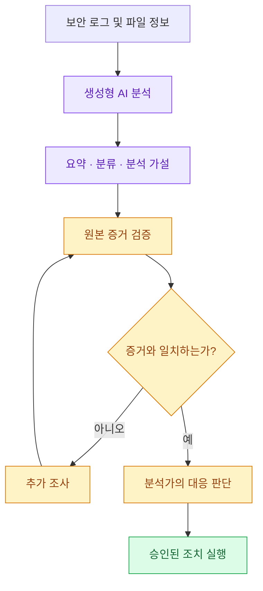
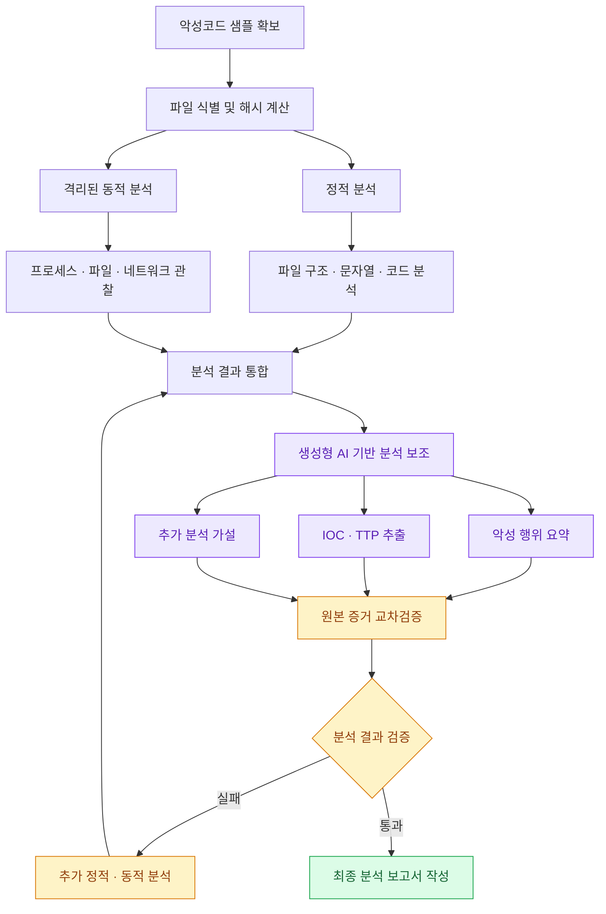

# AI·보안·해킹 개요

## 2. 생성형 AI와 보안

### 2.1 보안 업무의 주요 문제

보안팀은 서버, PC, 클라우드에서 생성되는 대량의 로그와 경보를 분석해야 한다.

일반적인 보안 대응 절차는 다음과 같다.

1. 수집 (Collection): 서버·PC·클라우드의 로그 및 보안 경보 수집
2. 정리 (Processing): 긴 이벤트, 난독화 코드, 위협정보 분석 및 구조화
3. 판단 (Analysis): 실제 공격 여부, 공격 원인, 피해 범위 파악
4. 대응 (Response): 시스템 격리, 계정 조치, 사고 보고 및 재발 방지

생성형 AI는 정보를 읽기 쉬운 형태로 변환하고, 분석가가 의사결정하는 데 필요한 시간을 줄이는 데 활용된다.

### 2.2 생성형 AI의 역할과 한계

| 잘하는 작업           | 맡기면 위험한 작업     |
| ---------------- | -------------- |
| 긴 로그 및 경보 요약     | 검증 없이 사실 확정    |
| 자연어를 탐지 쿼리로 변환   | 무승인 시스템 변경     |
| 침해사고 보고서 초안 작성   | 자동 차단·격리       |
| 조사 질문 및 분석 가설 생성 | 민감정보의 무단 외부 전송 |
| 탐지 규칙 초안 작성      | 원본 증거 없는 최종 판정 |

생성형 AI는 환각(Hallucination)으로 존재하지 않는 사건이나 출처를 만들어낼 수 있다.

> → AI는 분석을 보조하고, 최종 판단과 대응은 보안 분석가가 수행한다.

### 2.3 Human-in-the-loop

생성형 AI의 의사결정 과정에 사람의 검증과 승인을 포함하는 구조다.



## 3. AI를 활용한 보안관제 (SOC)

### 3.1 보안 경보의 타임라인 구성

서로 다른 보안 장비에서 발생한 이벤트를 하나의 사건 흐름으로 정리한다.

| 시간    | 이벤트      | 내용                    |
| ----- | -------- | --------------------- |
| 09:12 | 메일 신고    | 사용자가 의심 첨부파일 신고       |
| 09:18 | 엔드포인트 경보 | 동일 장비에서 의심스러운 프로세스 실행 |
| 09:24 | 네트워크 이벤트 | 외부 도메인 조회 발생          |

AI는 이 정보를 토대로 사고 타임라인 초안을 생성할 수 있다.

다만 각 이벤트가 실제로 연관된 사건인지 확인하기 위해 이벤트 ID, 발생 시각, 원본 로그를 비교해야 한다.

### 3.2 보안 경보 우선순위 결정

보안 경보의 중요도는 탐지 규칙의 심각도만으로 결정하지 않는다.

주요 판단 요소:

- 탐지 심각도: 탐지된 행위와 규칙의 신뢰도
- 자산 중요도: Domain Controller, 관리자 단말, 업무 핵심 서버 여부
- 외부 노출: 인터넷에서 접근 가능한지
- 계정 권한: 일반 사용자 또는 관리자 권한인지

AI는 이러한 요소를 종합하여 잠정 우선순위와 추가 확인 항목을 제안할 수 있다.

## 4. 위협정보 분석: IOC와 TTP

### 4.1 IOC (Indicator of Compromise)

침해지표는 공격이나 침해사고의 흔적을 확인하는 데 사용하는 정보다.

대표적인 IOC:

- 파일 해시(Hash)
- IP 주소
- 도메인
- URL

예를 들어 알려진 악성 IP와 통신한 기록이 내부 방화벽 로그에 존재하는지 검색할 수 있다.

다만 공격자는 IP나 도메인 등을 쉽게 변경할 수 있어 IOC가 빠르게 오래된 정보가 될 수 있다.

### 4.2 TTP (Tactics, Techniques, Procedures)

공격자의 전술·기법·절차를 의미한다.

| 구분         | 의미              | 예시                    |
| ---------- | --------------- | --------------------- |
| Tactics    | 공격자가 달성하려는 목적   | 초기 침투, 권한 상승          |
| Techniques | 목적을 달성하는 방법     | 피싱, 자격증명 탈취           |
| Procedures | 공격기법의 구체적 실행 방식 | 특정 명령어나 도구를 사용한 실행 절차 |

### 4.3 IOC와 TTP 비교

| 항목     | IOC              | TTP            |
| ------ | ---------------- | -------------- |
| 중심     | 공격의 흔적           | 공격 행동          |
| 대표 데이터 | Hash, IP, Domain | 공격 전술·기법·절차    |
| 활용     | 동일 흔적 검색         | 행동 패턴 탐지       |
| 한계     | 쉽게 변경 가능         | 맥락과 로그 데이터가 필요 |

핵심: IOC는 무엇이 관측되었는지, TTP는 공격자가 어떻게 행동하는지를 설명한다.

## 5. AI 기반 Threat Hunting과 탐지 규칙

### 5.1 자연어 기반 헌팅 쿼리 생성

보안 분석가는 자연어로 조사 조건을 작성하고 AI를 통해 탐지 쿼리 초안을 생성할 수 있다.

예시 질문:

> 최근 24시간 동안 Office 프로그램에서 시작된 의심스러운 실행 행위를 찾아라.

AI가 변환할 수 있는 쿼리 언어:

- KQL: Microsoft Sentinel, Defender 등에서 사용하는 검색 언어
- SPL: Splunk의 Search Processing Language
- EDR Query: 엔드포인트 보안 제품별 검색 문법

검증 절차는 다음과 같다.

```
자연어 질문
   ↓
AI의 탐지 쿼리 초안
   ↓
실제 로그 스키마 확인
   ↓
테이블·필드·시간대 검증
   ↓
쿼리 실행 및 표본 분석
   ↓
오탐·미탐 검토
```

### 5.2 Sigma 기반 탐지 규칙

Sigma는 SIEM 제품에 대한 종속성을 줄이기 위해 사용하는 탐지 규칙 형식이다.

```
탐지할 의심 행위 정의
          ↓
     Sigma Rule
          ↓
대상 SIEM 문법으로 변환
          ↓
     탐지 규칙 테스트
          ↓
      실무 환경 적용
```

주의할 점은 규칙이 정상적으로 실행되는 것과 실제 공격을 정확하게 탐지하는 것은 별개의 문제라는 것이다.

정상·악성 표본을 함께 테스트하고 로그 수집 여부와 예외 조건을 검증해야 한다.

## 6. 취약점 관리와 클라우드 보안

### 6.1 취약점 대응 우선순위

취약점 우선순위를 결정할 때 CVSS 점수만 사용하는 것은 충분하지 않다.

| 요소     | 확인 사항                       |
| ------ | --------------------------- |
| CVE    | 취약점의 식별 정보 및 내용             |
| CVSS   | 취약점의 기술적 심각도                |
| 공급사 권고 | 영향받는 버전 및 수정 버전             |
| 악용 정황  | 실제 공격에 사용된 사례가 있는지          |
| 자산 중요도 | 핵심 서비스 및 시스템에 영향이 있는지       |
| 노출 여부  | 외부에서 취약점에 접근할 수 있는지         |
| 보완 통제  | WAF, 접근통제 등 위험 완화 수단이 존재하는지 |

AI는 이를 종합한 우선순위와 임시 완화 방안을 제안하며, 최종 적용은 사람이 승인한다.

### 6.2 클라우드 보안 설정 분석

생성형 AI는 IAM, Kubernetes, 네트워크 구성에 존재할 수 있는 보안 설정 오류를 탐색하는 데 활용된다.

| 영역         | 주요 위험                             |
| ---------- | --------------------------------- |
| IAM        | 와일드카드 권한, 불필요한 관리자 권한             |
| Storage    | 공개된 저장소                           |
| Network    | 지나치게 넓은 Inbound Rule              |
| Secret     | API Key와 Token의 평문 저장             |
| Container  | `privileged`, `hostPath` 등 고위험 설정 |
| Kubernetes | 불필요한 서비스 간 통신 허용                  |

안전한 설정 변경은 정책 검사 → 테스트 → 코드 리뷰 → 승인된 적용 절차를 따라야 한다.

## 7. 피싱 메일 분석과 사고 보고서

### 7.1 피싱 메일 분석

피싱 메일의 본문만으로 악성 여부를 판단하지 않고 실제 메일 헤더와 사용자 활동을 함께 조사한다.

| 분석 단계   | 확인 정보                  |
| ------- | ---------------------- |
| 발신자     | 표시 주소, Reply-To, 인증 결과 |
| 링크·첨부파일 | URL, Redirect, 파일 해시   |
| 사용자 활동  | 링크 클릭 여부, 이후 로그인       |
| 영향 범위   | 동일 메일 수신자, 관련 계정       |
| 대응      | 차단·격리 필요성 및 승인         |

### 7.2 사고 보고서 초안 작성

AI는 다음 정보를 정리할 수 있다.

- 사고 발생 및 탐지 시각
- 영향을 받은 시스템·계정
- 공격 흐름과 조사 결과
- 수행한 대응 조치
- 미확인 사항 및 추가 조사 과제

보고서에서 가장 중요한 것은 사실과 추정의 분리다.

| 분류              | 의미               |
| --------------- | ---------------- |
| 사실 (Fact)       | 원본 증거로 확인된 내용    |
| 추정 (Assumption) | 확인되지 않았지만 가능한 설명 |
| 미확인 (Unknown)   | 추가 조사가 필요한 정보    |
| 조치 (Action)     | 승인 또는 실행된 대응 활동  |

## 8. AI 시대의 보안 기본기

생성형 AI 기술이 발전해도 보안 분석을 위해 필요한 기초 기술은 유지된다.

| 분야      | 핵심 지식              | 주요 활용                    |
| ------- | ------------------ | ------------------------ |
| 시스템     | 프로세스, 파일, 권한       | 악성코드 실행 및 권한 상승 분석       |
| 네트워크    | IP, DNS, 통신 흐름     | C2 통신 및 침해 트래픽 분석        |
| 웹 보안    | HTTP 요청, 인증, 입력 검증 | SQL Injection 등 웹 취약점 이해 |
| 암호학     | 키, 암호화, 해시, 서명     | 파일 무결성 및 암호화 행위 분석       |
| 디지털 포렌식 | 증거, 타임라인, 무결성      | 침해사고 조사와 증거 보존           |

AI가 생성한 결과를 검증하려면 해당 기술을 이해하고 있어야 한다.

## 9. 악성코드 분석 기초

### 9.1 정적 분석과 동적 분석

정적 분석 (Static Analysis)

악성코드를 실행하지 않고 파일 구조와 코드를 조사한다.

주요 분석 항목

- 파일 형식
- 파일 해시
- 문자열
- 실행 파일 구조
- 디스어셈블

장점: 실행하지 않고 분석 가능        한계: 패킹·난독화로 내용이 숨겨질 수 있음

---

동적 분석 (Dynamic Analysis)

격리된 환경에서 악성코드를 실행하여 실제 행위를 관찰한다.

주요 분석 항목

- 프로세스 실행
- 파일 변경
- 레지스트리 변경
- 네트워크 통신
- 지속성 확보 시도

장점: 실제 실행 행위 확인        한계: 환경 탐지·시간 지연 등에 의해 행동이 숨겨질 수 있음

### 9.2 생성형 AI 보조 악성코드 분석 구조



AI의 설명은 원본 바이트, 코드 및 실제 샌드박스 실행 증거와 일치해야 한다.

## 10. Sandbox와 악성코드 행위 분석

### 10.1 Sandbox

Sandbox는 의심 파일을 통제된 환경에서 실행하여 악성 행위를 관찰하는 분석 환경이다.

주요 구성:

```
의심 파일 또는 URL
          ↓
    격리된 가상 머신
          ↓
   악성코드 실행 및 관찰
          ↓
프로세스 · 파일 · 네트워크
          ↓
    분석 결과 및 IOC
```

실제 샌드박스의 지원 파일 형식과 관찰 기능은 제품 및 운영 환경에 따라 달라진다.

### 10.2 샌드박스 보고서 해석

분석 보고서에서는 다음 항목을 확인한다.

| 항목      | 핵심 확인 사항                       |
| ------- | ------------------------------ |
| 위험 판정   | 어떤 탐지 규칙과 행위에 근거했는가?           |
| 프로세스 트리 | 어떤 부모 프로세스가 자식 프로세스를 실행했는가?    |
| 파일 변경   | 생성·수정한 파일이 무엇인가?               |
| 설정 변경   | 자동 실행이나 지속성 확보를 시도했는가?         |
| 네트워크    | DNS 조회, 연결 시도, 실제 통신 성공 여부     |
| 교차검증    | EDR, DNS, 원본 로그와 분석 결과가 일치하는가? |

샌드박스에서 높은 위험 점수가 나왔다고 해서 점수만으로 결론을 내리지 않는다. 실제 관측된 행위와 증거를 확인해야 한다.

## 11. 악성코드 분석과 암호학

암호화 기술은 정상적인 정보 보호에도 사용되지만 공격자도 악용할 수 있다.

| 기술      | 정상적인 활용           | 악성코드에서의 악용              |
| ------- | ----------------- | ----------------------- |
| 대칭키 암호화 | 데이터 기밀성 보호        | 랜섬웨어의 파일 암호화            |
| 공개키 암호화 | 안전한 키 교환 및 데이터 보호 | 복호화 키의 접근 제한            |
| TLS     | 네트워크 통신 보호        | C2 통신 내용 은닉             |
| Hash    | 파일 식별, 무결성 확인     | 샘플 식별 및 비교에 사용          |
| 전자서명    | 출처 및 무결성 검증       | 정상 프로그램으로 위장할 단서로 악용 가능 |

### 네트워크 기반 분석

악성코드의 네트워크 활동은 다음을 연결해 분석한다.

```
DNS 조회
   ↓
네트워크 연결 시도
   ↓
연결한 프로세스 확인
   ↓
Proxy · EDR · Firewall 로그 비교
   ↓
통신 목적 및 악성 여부 조사
```

통신이 암호화되어 있으면 내용이 보이지 않을 수 있으므로 DNS, 목적지 IP, 포트, 시간, 프로세스와 같은 메타데이터가 중요하다.

## 12. 패킹과 난독화

### 12.1 Packing

실행 파일의 원래 코드를 압축·암호화하거나 변형해 저장하고, 실행 과정에서 복원하는 기술이다.

악성코드에서는 실제 코드를 숨겨 정적 분석을 어렵게 만들 수 있다.

### 12.2 Obfuscation

프로그램의 기능은 유지하면서 코드 구조와 표현을 복잡하게 만들어 분석을 방해하는 기술이다.

| 구분    | Packing            | Obfuscation         |
| ----- | ------------------ | ------------------- |
| 목적    | 실행 코드 은닉           | 코드 의미 파악 방해         |
| 방법    | 압축·암호화 후 실행 시 복원 등 | 문자열 암호화, 제어 흐름 변형 등 |
| 분석 영향 | 원래 코드 접근이 어려움      | 코드 이해가 어려움          |
| 대응    | 구조 및 격리 실행 결과 분석   | 코드 흐름과 실행 행위 비교     |

정상적으로 서명된 파일처럼 보이더라도 실제 행위와 서명 유효성을 확인해야 한다.

## 13. 웹 보안: SQL Injection

**SQL Injection(SQLi)**은 사용자 입력이 SQL 쿼리의 데이터가 아니라 명령의 일부로 해석될 때 발생하는 취약점이다.

### 취약한 설계

사용자 입력을 검증 없이 SQL 문자열에 직접 연결하는 방식이다.

```
query = "SELECT * FROM users WHERE name = '" + username + "'"
```

이 경우 입력값에 따라 SQL 쿼리의 의미가 변경될 수 있다.

### 방어 방법

**매개변수화된 쿼리(Parameterized Query)**를 사용하여 SQL 명령과 데이터를 분리한다.

```
cursor.execute(    "SELECT * FROM users WHERE name = ?",    (username,))
```

추가적인 방어 방법:

- 입력값 형식 및 허용 목록 검증
- 최소 권한 데이터베이스 계정
- 보안 코드 리뷰
- 허가된 테스트 환경에서 검증

## 14. 디지털 포렌식

디지털 포렌식(Digital Forensics)은 디지털 증거를 수집·보존·분석하여 사건을 조사하는 과정이다.

### 주요 절차

| 단계   | 핵심 작업                  |
| ---- | ---------------------- |
| 기록   | 원본 출처, 수집자, 시각, 시간대 기록 |
| 무결성  | 수집 전후 파일 해시 비교         |
| 타임라인 | 시스템 및 로그 시각의 차이 고려     |
| 보관   | 원본 보호 및 분석용 복사본 사용     |

특히 사건을 재현하거나 법적 증거로 활용할 가능성이 있는 경우 **Chain of Custody(증거 관리 연속성)**가 중요하다.

누가, 언제, 어떤 목적으로 증거를 수집·이동·분석했는지 기록해야 한다.

## 15. 생성형 AI의 보안 위험과 안전한 실습

### 15.1 AI 사용 시 두 가지 경계

| 구분     | 보호 원칙                 |
| ------ | --------------------- |
| 데이터 경계 | 승인된 AI 서비스 사용         |
| 데이터 경계 | 민감정보와 실제 샘플의 외부 전송 제한 |
| 데이터 경계 | 분석 대상의 프롬프트 인젝션 방어    |
| 행동 경계  | AI 출력의 원본 검증          |
| 행동 경계  | 시스템 변경 권한 통제          |
| 행동 경계  | 입력·출력·승인 과정 감사 기록     |

Prompt Injection은 분석 대상에 포함된 텍스트를 AI가 실제 명령으로 오해하도록 유도하는 공격이다.

따라서 악성코드에 포함된 문자열이나 로그 내용은 지시가 아닌 신뢰할 수 없는 분석 데이터로 처리해야 한다.

### 15.2 안전한 해킹 실습

해킹 실습은 반드시 명시적으로 허가된 환경에서 진행한다.

- 본인 소유 또는 승인받은 시스템만 사용
- 가상 머신과 격리된 네트워크 활용
- 테스트 계정 사용
- 실습 대상·목적·시간·변경 내용 기록
- 실습 종료 후 환경 복구 및 샘플 안전 보관

실습의 목적은 취약점의 원리를 이해하고 개선 방법을 확인하는 것이다.

## 16. 종합 실습: 의심 첨부파일 신고

강의자료의 종합 실습은 의심스러운 이메일 첨부파일 신고가 발생한 상황을 다룬다.

### 제공된 증거

| 증거              | 분석 목적                |
| --------------- | -------------------- |
| 메일 신고 시각과 발신자   | 사고 발생 경위 확인          |
| EDR 프로세스·파일 이벤트 | 첨부파일 실행 및 후속 행위 확인   |
| Sandbox 행위·DNS  | 악성코드 실행 행위와 외부 통신 확인 |
| SIEM 로그인 기록     | 계정 침해 여부 조사          |

### 분석가의 최종 산출물

1. 확인된 사실, 추정, 미확인 항목을 구분한 사고 타임라인
2. 파일 해시, 이벤트 ID 등 원본 증거에 대한 참조
3. 추가로 확인해야 할 질문과 조사 우선순위
4. 승인 전 단계의 격리·차단 조치 제안

이 실습은 생성형 AI를 활용해 분석 초안을 만들더라도 원본 증거와 사람의 검증을 중심으로 사고를 조사해야 한다는 점을 강조한다.

## 17. 생성형 AI 도입 및 평가

생성형 AI의 보안 업무 도입은 작은 범위에서 시작하고 측정 가능한 기준을 통해 확대한다.

| 단계  | 설명                        |
| --- | ------------------------- |
| 파일럿 | 경보 요약처럼 위험이 낮은 반복 업무 선정   |
| 품질  | 증거 누락, 오탐, 잘못된 IOC 비율 측정  |
| 효율  | AI 처리 시간과 검증·재작업 시간 비교    |
| 안전  | 민감정보 노출, 승인 누락, 고위험 출력 확인 |
| 확장  | 품질과 안전 기준 충족 후 업무 범위 확대   |

핵심은 AI가 얼마나 빠르게 출력하는지가 아니라 검증을 포함한 전체 업무의 품질과 효율이 얼마나 개선되었는지이다.

## 자료 출처

- [MITRE ATT&CK](https://attack.mitre.org/) — 공격 전술 및 기법 분류
- [Sigma 공식 사이트](https://sigmahq.io/) — 탐지 규칙 표준
- [OWASP SQL Injection](https://owasp.org/www-community/attacks/SQL_Injection) — SQL 인젝션 원리 및 대응
- [NIST AI RMF](https://www.nist.gov/itl/ai-risk-management-framework) — AI 위험 관리 체계
