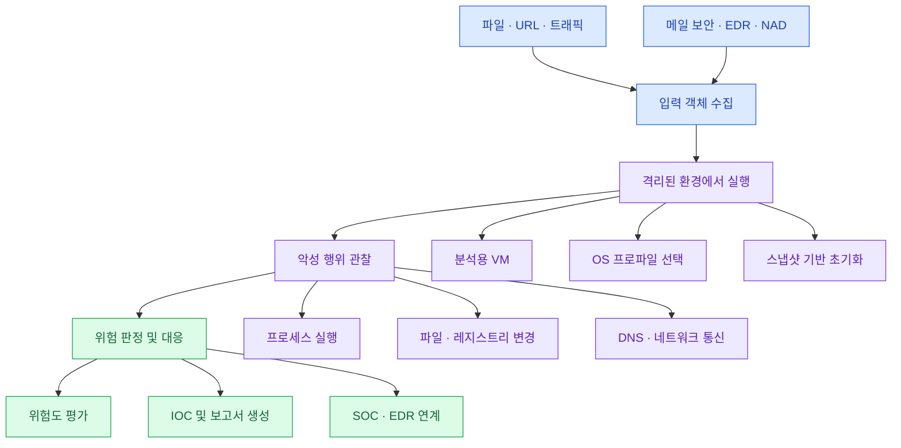
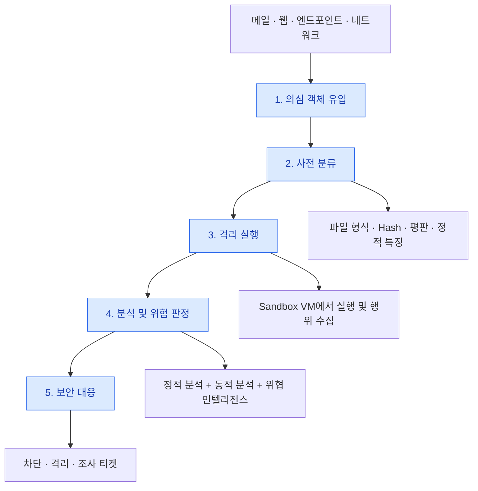
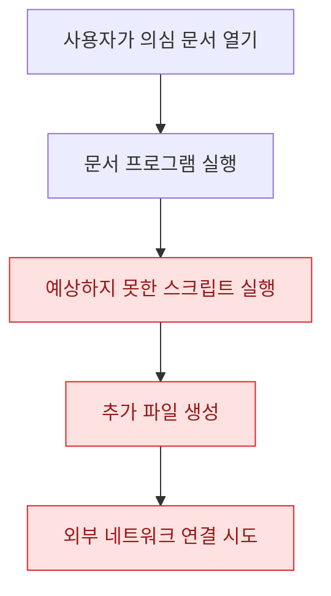
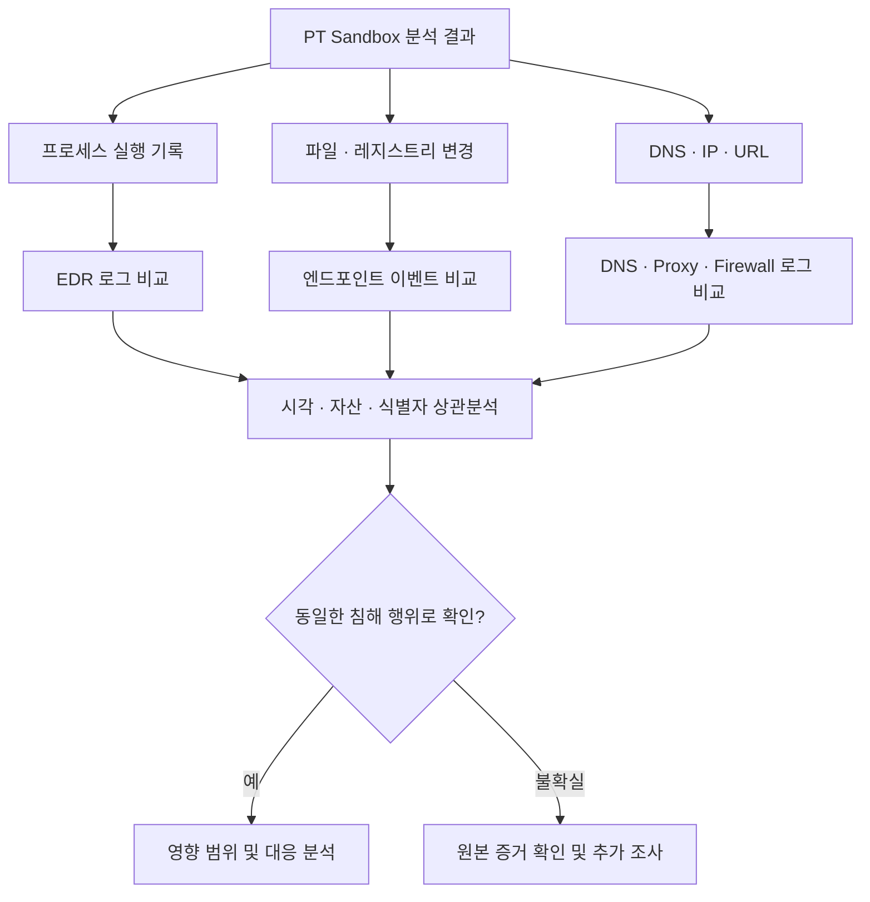
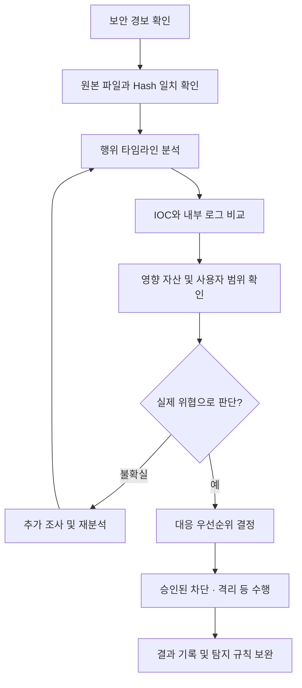

# PT Sandbox

## 1. PT Sandbox 개요

### 1.1 PT Sandbox란?

**PT Sandbox**는 격리된 가상 환경에서 의심 파일과 네트워크 객체를 실행·관찰하여 악성 행위와 위험도를 분석하는 보안 샌드박스(Security Sandbox) 솔루션이다.

[Айтишники против шифровальщиков: как победить злосчастный вирус / Хабр](https://images.openai.com/static-rsc-4/kSNlG9Aj-PVVbPwehHjc9BFwNNLmmraTNJPziozxh8uYSgYr-l7bH5D1dULrgpTMcssWgjo5EDSXqcejpKCeLm4SNXDK634ncNvpx9b8ApbXlZTMTH40hTKFu5Kwi0fxzjjWYiOewvAAy_f1T5Mzkc200y-DvdsTWjVl7cLzivY?purpose=inline)

[PT Sandbox 5.27: обзор возможностей сетевой песочницы Positive Technologies](https://images.openai.com/static-rsc-4/DYWi79PuJrSrYh8asz_SywvJm1JFAowBWEaIm_gVoc0ltdShVXg2CS4NPGjWCQyN-1dzbW1_XDnMAsRTxwyJH5WolpvWjLGDmNcACBDOPMqrlvjJAcTUg0AXA7DM2nSqwRMNLHMjYcSTzWl_TH31fccbrZysZjWs-rmiyT_-_pQ?purpose=inline)

[PT Sandbox — Сетевая песочница для защиты от неизвестного вредоносного ПО | Positive Technologies](https://images.openai.com/static-rsc-4/LjzCvQEc2KJiTv0gZh517m2wkwZ-hrnHr-DTIr5HYxd_Zl5WHCf0HK5T2d8UKbz_LGxSPgo6IdFsPsiNcHDcItrryXK1B47XVvaWPTFtWtImgaO_Z931Z0JqI2P1-TR0x5tGLueLdYNpZv4FxMTajZYRTf-gF4qYvq-xIBUK0as?purpose=inline)

### 1.2 핵심 목적

| 목적            | 설명                                 |
| ------------- | ---------------------------------- |
| 알려지지 않은 위협 탐지 | 기존 시그니처로 탐지하기 어려운 악성 행위를 분석        |
| 악성 행위 관찰      | 파일 실행, 프로세스 생성, 네트워크 연결, 시스템 변경 확인 |
| 보안 분석가 지원     | 다양한 분석 증거를 제공하여 악성 여부 판단 지원        |
| 대응 자동화 연계     | SOC, EDR 등 기존 보안 시스템과 연계           |

PT Sandbox는 단순히 파일이 악성인지 판단하는 데 그치지 않고, 어떤 행위 때문에 위험하다고 판단했는지 근거를 제공한다.

제품의 세부 기능과 연동 범위는 버전, 라이선스, 배포 환경에 따라 달라질 수 있다.

## 2. PT Sandbox의 기본 구조

PT Sandbox는 크게 네 단계로 구성된다.



### 단계별 주요 기능

| 단계    | 구성 요소        | 주요 역할                |
| ----- | ------------ | -------------------- |
| 입력    | 파일·URL·트래픽   | 의심 객체 수집             |
| 격리 실행 | VM·OS 프로파일   | 통제된 가상 환경에서 실행       |
| 행위 관찰 | 프로세스·파일·네트워크 | 시스템과 통신의 변화 기록       |
| 판정·대응 | 위험도·IOC·보고서  | 분석 결과 제공 및 보안 시스템 연계 |

스냅샷(Snapshot) 은 가상 머신의 특정 상태를 저장한 것으로, 샘플 분석 후 환경을 초기 상태로 복원하는 데 사용된다.

## 3. PT Sandbox 분석 절차

### 3.1 전체 분석 흐름



### 3.2 단계별 설명

1. 유입 (Collection): 메일, 웹, 엔드포인트, 네트워크에서 의심 파일 또는 객체를 수집한다.
2. 분류 (Classification): 분석 전에 파일 형식과 기본적인 위험도를 확인한다.
	- SHA-256 등 파일 해시
	- 파일 형식
	- 기존 악성코드 평판
	- 정적 분석 특징
3. 실행 (Execution): 대상 파일 유형에 적합한 격리된 가상 환경에서 실행한다. 이 과정에서 운영체제, 애플리케이션, 분석 프로파일을 선택할 수 있다.
4. 판정 (Verdict): 정적 분석, 동적 분석, 위협 인텔리전스를 종합해 악성 여부와 위험도를 평가한다.
5. 대응 (Response): 분석 결과를 기반으로 대응 절차를 진행한다.
	- 악성 파일 차단
	- 감염 단말 격리
	- 침해사고 조사
	- 조사 티켓 생성
	- 탐지 규칙 보완

자동 대응은 조직의 승인 정책과 영향도 평가에 따라 수행해야 한다.

## 4. 악성코드 탐지 기법

PT Sandbox는 여러 분석 관점의 증거를 종합하여 악성 행위를 탐지한다.

| 구분                         | 분석 대상     | 주요 특징                   |
| -------------------------- | --------- | ----------------------- |
| 정적 분석 (Static Analysis)    | 실행 전 파일   | 서명, 규칙, 파일 구조, 메타데이터    |
| 동적 분석 (Dynamic Analysis)   | 실행 중 프로그램 | 프로세스, 파일, 레지스트리, 시스템 호출 |
| 네트워크 분석 (Network Analysis) | 통신 행위     | DNS, IP, 프로토콜, 네트워크 트래픽 |
| 추가 판단 기법                   | 여러 분석 결과  | 행위 규칙, 머신러닝, 위협 인텔리전스   |

### 4.1 정적 분석

파일을 실행하지 않고 악성코드의 구조와 특징을 조사한다.

### 4.2 동적 분석

파일을 실제로 실행하여 프로세스, 파일, 레지스트리 등의 변화를 확인한다.

### 4.3 네트워크 분석

악성코드 실행 과정에서 발생하는 외부 통신을 확인한다.

- DNS 조회
- IP 연결
- URL 요청
- 프로토콜
- 트래픽 패턴

핵심: 하나의 지표만으로 악성 여부를 확정하지 않고 여러 증거를 종합해야 한다.

## 5. PT Sandbox의 분석 대상

| 분석 대상   | 예시                       |
| ------- | ------------------------ |
| 실행 파일   | EXE 등                    |
| 스크립트    | PowerShell, JavaScript 등 |
| 문서      | 의심스러운 Office 문서 등        |
| 압축 파일   | ZIP 등                    |
| 네트워크 객체 | 트래픽 및 다운로드 객체            |

분석 전에는 해당 객체에 대한 기본 정보도 기록해야 한다.

```
파일명
파일 형식
SHA-256 Hash
파일 출처
수신 시각
분석 요청자
```

비밀번호가 있는 압축 파일이나 특수 형식은 지원 여부와 처리 정책을 확인해야 한다.

또한 업무 데이터나 개인정보가 포함된 파일은 조직의 업로드 기준을 준수해야 한다.

## 6. 분석 결과에서 확인해야 할 증거

PT Sandbox 결과를 분석할 때는 단순한 악성 여부보다 실제 관측된 행위와 증거가 중요하다.

| 분석 항목    | 확인 내용                |
| -------- | -------------------- |
| 위험 판정    | 악성 여부, 위험도, 탐지 근거    |
| 프로세스 트리  | 부모 프로세스와 자식 프로세스     |
| 파일 변경    | 생성·수정된 파일            |
| 레지스트리 변경 | 시스템 설정 및 자동 실행 관련 변경 |
| 지속성      | 재부팅 후 실행을 유지하려는 시도   |
| 네트워크     | DNS, IP, URL 및 통신 흐름 |
| 아티팩트     | 실행 중 생성되거나 추출된 객체    |
| 보고서      | 타임라인, 탐지 규칙, 행위 시각화  |

## 7. 위험 판정과 프로세스 트리 분석

### 7.1 위험 판정 (Verdict)

위험 판정은 분석 과정에서 확인한 여러 단서를 종합한 결과이다.

예를 들어 다음과 같은 실행 흐름을 의심할 수 있다.



문서 프로그램이 예상하지 못한 스크립트를 실행했다는 사실은 중요한 분석 단서이다.

다만 이 행위만으로 모든 문서가 악성이라고 판단할 수는 없으므로 원본 증거와 실행 맥락을 함께 확인해야 한다.

### 7.2 프로세스 트리 (Process Tree)

프로세스 트리는 프로그램 사이의 부모–자식 실행 관계를 나타낸다.

예시:

```
explorer.exe
    └── WINWORD.EXE
          └── wscript.exe
                └── child_process.exe
```

분석 포인트:

- 어떤 프로세스가 최초 실행되었는가?
- 부모 프로세스가 자식 프로세스를 생성한 이유는 무엇인가?
- 정상적인 실행 관계인가?
- 자식 프로세스가 다른 파일을 생성하거나 실행했는가?

### 7.3 지속성 (Persistence)

공격자가 시스템 재부팅 후에도 악성코드를 계속 실행시키기 위해 사용하는 기법이다.

대표적인 예:

- 자동 실행 레지스트리
- 시작 프로그램
- 예약 작업
- 서비스 등록

주의할 점은 지속성 확보 시도가 관찰되었다고 해서 실제 지속성이 확보된 것은 아니라는 점이다.

## 8. 파일·레지스트리·네트워크 흔적 분석

### 8.1 파일 및 레지스트리 분석

악성코드가 실행되면서 생성하거나 수정한 파일과 시스템 설정을 확인한다.

| 분석 항목 | 확인 사항             |
| ----- | ----------------- |
| 파일 생성 | 새로 생성된 파일 경로와 이름  |
| 파일 수정 | 기존 파일의 변경 여부      |
| 레지스트리 | 자동 실행 및 시스템 설정 변경 |
| 프로세스  | 해당 변경을 수행한 프로세스   |
| 변경 시각 | 이벤트 발생 순서         |

파일이 생성되었다는 사실만으로 악성 여부를 확정할 수 없다. 어떤 프로세스가 어떤 목적으로 파일을 생성했는지 확인해야 한다.

### 8.2 네트워크 분석

악성코드가 외부 시스템과 통신하는지 확인한다.

대표적인 분석 대상:

- DNS Query
- 목적지 IP
- URL
- 통신 프로토콜
- 연결 성공 여부

다음 두 가지는 구분해야 한다.

연결 시도: 외부 서버와 통신하려는 행위가 발생함.

연결 성공: 실제 네트워크 연결이 성립함.

또한 정상적인 도메인이나 클라우드 서비스도 공격에 악용될 수 있으므로 단순히 알려진 정상 도메인이라는 이유로 안전하다고 판단해서는 안 된다.

### 8.3 조직 내부 로그와 교차검증



## 9. PT Sandbox와 보안 솔루션 연계

PT Sandbox는 다른 보안 솔루션과 연동하여 의심 객체를 검사하고 분석 결과를 활용할 수 있다.

| 연동 대상     | 주요 역할                     |
| --------- | ------------------------- |
| 메일 보안     | 첨부파일 및 URL 검사             |
| NAD       | 네트워크에서 발견한 의심 객체 및 트래픽 분석 |
| EDR       | 엔드포인트에서 탐지된 파일 조사 및 대응    |
| 웹 업로드·저장소 | 업로드되거나 저장된 파일 검사          |
| 개발 저장소    | 유입된 파일의 위협 검사             |

### NAD (Network Attack Detection)

네트워크 트래픽을 분석하여 공격이나 의심스러운 통신을 탐지하는 보안 시스템이다.

### 연동 전 검토 사항

- 어떤 객체를 분석할 것인가?
- 분석 응답시간은 어느 정도 허용할 것인가?
- 분석 실패 시 어떻게 처리할 것인가?
- 어떤 조건에서 자동 차단할 것인가?
- 오탐이 발생하면 어떻게 복구할 것인가?

## 10. 보안 분석가의 판단 절차

PT Sandbox의 분석 결과는 보안 분석가의 최종 판단을 지원한다.



### 주요 검증 항목

| 단계     | 분석가 확인 사항            |
| ------ | -------------------- |
| 원본 확인  | 파일명, 해시, 식별자 일치      |
| 행위 분석  | 프로세스·파일·네트워크 타임라인    |
| 오탐 검토  | 정상 프로그램이나 자동화 작업 여부  |
| IOC 검증 | EDR·DNS·Proxy 로그와 비교 |
| 영향 분석  | 감염 가능성이 있는 자산과 사용자   |
| 대응     | 위험도와 업무 영향에 따른 조치 결정 |
| 사후 관리  | 근거 기록, 재분석, 탐지 규칙 개선 |

## 11. PT Sandbox 운영 보안

PT Sandbox 자체도 악성코드를 다루는 시스템이므로 철저한 보안 관리가 필요하다.

| 관리 영역   | 필수 보안 조치                |
| ------- | ----------------------- |
| 네트워크 격리 | 관리망과 분석망 분리             |
| 네트워크 통제 | 샌드박스 통신 경로 제한           |
| 접근통제    | RBAC 기반 권한 관리           |
| 인증      | 관리자 MFA 적용              |
| 감사      | 접근 및 분석 이력 기록           |
| 데이터 보호  | 샘플 저장·전송·삭제 정책          |
| 환경 관리   | VM 이미지 및 분석 프로파일 변경 통제  |
| 성능 관리   | 동시 분석 수, 대기시간, 실패율 모니터링 |

### RBAC (Role-Based Access Control)

사용자의 역할에 따라 접근 권한을 부여하는 방식이다.

### MFA (Multi-Factor Authentication)

두 가지 이상의 서로 다른 인증 요소를 사용하여 사용자를 인증하는 방식이다.

## 12. PT Sandbox의 한계와 안전 수칙

### 12.1 분석의 주요 한계

| 한계                    | 설명                         |
| --------------------- | -------------------------- |
| Sandbox Evasion       | 악성코드가 분석 환경을 감지하고 행위를 숨김   |
| Delayed Execution     | 특정 시간이 지난 후 악성 행위를 실행      |
| Environment Awareness | 특정 OS·애플리케이션 환경에서만 동작      |
| 분석 환경 의존성             | VM 및 프로파일에 따라 결과가 달라짐      |
| 미탐지                   | 악성 행위가 실제로 발생하지 않아 탐지되지 않음 |

특히 다음 원칙이 중요하다.

> 미탐지(Not Detected)는 무해함(Benign)을 의미하지 않는다.

샌드박스에서 악성 행위가 관찰되지 않았더라도 실제 환경에서는 다른 결과가 발생할 수 있다.

### 12.2 안전한 운영 수칙

- 격리된 전용 분석 환경에서만 악성코드를 취급한다.
- 업무망이나 일반 사용자 PC에서 악성코드를 실행하지 않는다.
- 단일 탐지 결과에만 의존하지 않는다.
- 분석 환경과 실행 조건을 변경한 재분석을 검토한다.
- 자동 차단에는 업무 영향도, 복구 절차, 승인 기준을 적용한다.

## 자료 출처

- [Positive Technologies — PT Sandbox 제품 소개](https://global.ptsecurity.com/en/products/sandbox/)
- [MITRE ATT&CK — 공격 전술·기법 분류](https://attack.mitre.org/)