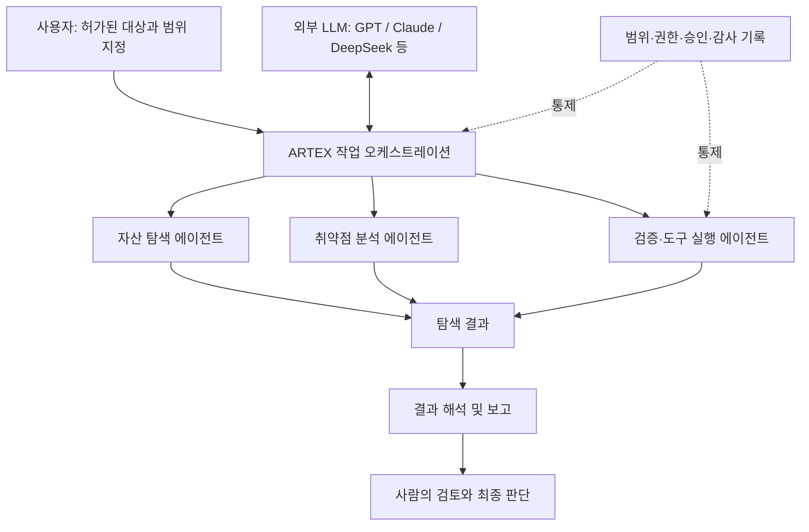

# 최근 보안 이슈: ARTEX

## 1. ARTEX란?

**ARTEX**는 대규모 언어 모델(LLM)과 복수의 AI 에이전트를 연계해 보안 자산 탐색, 취약점 확인, 도구 실행 등의 작업을 조율하는 **오픈소스 자율 침투테스트 시스템**으로 소개된다.

- ARTEX 자체가 독립적인 AI 모델인 것은 아니다.
- 외부 LLM을 연결해 침투테스트 단계의 계획·실행·결과 해석을 보조한다.
- GPT, Claude, DeepSeek 등과의 연동이 가능한 것으로 강의자료에 소개된다. 실제 지원 범위는 구현 버전과 구성에 따라 확인해야 한다.
- 사용자가 대상 범위를 정하고 위험한 실행을 승인·차단하며 기록을 남기는 운영 구조가 중요하다.

## 2. 작동 원리

위 다이어그램은 슬라이드의 특징 설명을 이해하기 쉽게 **개념적으로 재구성**한 것이다. ARTEX의 검증된 내부 구현도나 소스코드상 정확한 에이전트 구성도를 의미하지 않는다.

## 3. 외부 AI 모델과 ARTEX의 차이

| 항목 | 외부 LLM | ARTEX |
|---|---|---|
| 주요 역할 | 언어 이해·추론·작업 계획 보조 | 에이전트 및 침투테스트 작업 조율 |
| 그 자체로 실행 모델인가? | AI 모델 | AI 모델을 호출하는 응용 시스템 |
| 보안 작업 | 설명·판단·명령 제안 | 도구 실행 단계와 작업 흐름 연결 |
| 운영 위험 | 부정확한 판단·환각 | 부정확한 판단이 실제 도구 실행으로 이어질 가능성 |

즉 **LLM은 판단을 보조하는 구성 요소이고, ARTEX는 그 출력을 실제 보안 작업 흐름에 연결하는 시스템**이라는 구분이 핵심이다.

## 4. 다중 에이전트 기반 침투테스트

ARTEX와 같은 자율형 보안 도구에서는 여러 에이전트가 각자의 임무를 맡아 작업을 수행할 수 있다.

1. **대상 확인:** 명시적으로 허가된 IP, 도메인, 시스템의 범위를 확인한다.
2. **자산 탐색:** 서비스, 포트, 기술 스택 등의 정보를 수집한다.
3. **취약점 분석:** 수집된 정보를 바탕으로 보안 취약점 가능성을 식별한다.
4. **검증:** 승인된 방식으로 발견 내용을 검증한다.
5. **결과 정리:** 근거와 재현 조건을 포함해 보고서를 작성한다.
6. **사람의 승인:** 범위 변경 및 고위험 작업은 권한 있는 사람이 최종 결정한다.

> 위 단계는 강의자료의 '자산 탐색·취약점 확인·도구 실행 조율' 개념에 기반한 일반적인 실무 흐름이며, ARTEX의 특정 버전에서 모든 단계가 동일하게 구현되었다는 뜻은 아니다.

## 5. 관련 보안 이슈

강의자료는 ARTEX를 **공격 작업의 자동화를 촉진할 수 있는 AI 보안 기술**로 소개하며, 보안 분석·침투테스트 도구의 악용 가능성을 시사한다.

- 공격에 필요한 일부 탐색·분석 작업의 반복적 부담을 낮출 수 있다.
- 여러 도구와 분석 단계를 AI가 연결해 수행할 수 있다.
- 사람의 개입 없이 잘못된 표적을 조사하거나 권한을 벗어나는 행위를 수행하면 피해가 발생할 수 있다.
- AI 분석에 오류가 있으면 허위 취약점 보고, 불필요한 도구 실행 등으로 이어질 수 있다.

**유의:** PPT에 연결된 언론 기사 및 캡처의 주장은 원문과 날짜·사례의 검증 수준을 구분해 확인해야 한다. 이를 실제 침해사고의 기술적 원인으로 확정하지 않는다.

## 6. 유사 AI 침투테스트 도구 비교

| 도구 | 강의자료에 표시된 주체 | 자료상 특징 |
|---|---|---|
| **ARTEX** | 중국 개발자 'Autumn-27' | 외부 LLM을 연동해 취약점 탐색과 공격 명령 실행을 자동화하는 오픈소스 AI 도구 |
| **PentestGPT** | 싱가포르 난양공대 연구진 주도 | AI를 활용해 정찰, 취약점 탐색, 공격 흐름을 연결하는 침투테스트 프로젝트 |
| **Villager** | 중국 Cyberspike | Kali Linux 도구와 DeepSeek 모델을 결합한 테스트·공격 워크플로 자동화 프레임워크로 소개 |
| **Strix** | 미국 보안 스타트업 Strix | 여러 AI 에이전트가 협력해 취약점을 탐색하고 검증하는 오픈소스 도구로 소개 |

**주의:** 개발 주체·연계 모델·기술 특징은 강의자료의 비교 이미지에 기재된 설명을 옮긴 것이며, 독립 검증된 최신 사실로 단정하지 않는다.

## 7. 보안 관점의 대응 과제

| 통제 영역 | 권장 대응 |
|---|---|
| 대상 범위 | 테스트 대상 IP·도메인 및 시스템을 명확히 허가 |
| 권한 관리 | 도구와 에이전트에 최소 권한 부여 |
| 실행 승인 | 서비스 영향이 큰 단계는 Human-in-the-loop 승인 |
| 기록 관리 | 명령, 도구 호출, 결과, 승인자 및 실행 시각 기록 |
| 검증 | AI의 취약점 주장을 실제 근거와 교차검증 |
| 운영 환경 | 격리된 검증 환경과 속도·횟수 제한 사용 |
| 데이터 보호 | 자격증명 및 내부 자산 정보를 외부 LLM에 무단 전송하지 않음 |

## 9. 참고 출처

1. IT위키, ARTEX: https://itwiki.kr/w/ARTEX
2. 안랩 콘텐츠센터: https://www.ahnlab.com/ko/contents/content-center/36300
3. GitHub, `jiwoochris/artex-ko`: https://github.com/jiwoochris/artex-ko
4. IT조선, '주요 AI 침투테스트 도구 비교',
