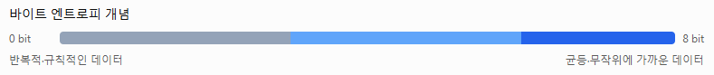
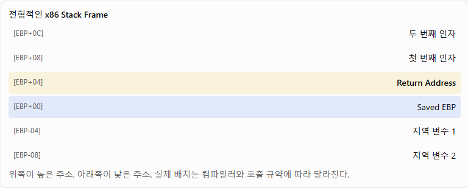

# 리버싱(Reversing) 통합 정리

## 1. 리버싱 개요

### 1.1 리버싱(Reverse Engineering)이란?

리버싱은 완성된 프로그램이나 바이너리 파일을 분석하여 내부 구조, 동작 원리, 알고리즘, 데이터 처리 방식 등을 파악하는 기술이다.

일반적인 소프트웨어 개발 과정과 반대 방향으로 분석한다.

```
[일반 개발]
소스 코드 → 컴파일 → 기계어 → 실행 파일

[리버싱]
실행 파일 → 기계어 분석 → 어셈블리어
          → 제어 흐름 분석 → 동작 원리 파악
```

주요 활용 분야는 다음과 같다.

- 악성코드 분석: 악성 행위, 네트워크 통신, 파일 조작 등을 확인
- 취약점 분석: 버퍼 오버플로우, 메모리 오류, 인증 우회 등 분석
- 디지털 포렌식: 삭제된 파일 복구, 숨겨진 데이터 및 실행 흔적 조사
- 소프트웨어 분석: 프로그램 구조, 함수 호출, 알고리즘 역분석

### 1.2 정적 분석과 동적 분석

| 구분    | 정적 분석                  | 동적 분석                      |
| ----- | ---------------------- | -------------------------- |
| 실행 여부 | 실행하지 않음                | 실행함                        |
| 분석 대상 | 파일 구조, 문자열, 코드         | 실제 실행 행동                   |
| 주요 도구 | PE-bear, Ghidra, IDA   | x64dbg, Wireshark, Procmon |
| 분석 정보 | Import, Section, 함수 구조 | API 호출, 메모리, 네트워크          |
| 특징    | 실행하지 않고 조사 가능          | 실제 동작 확인 가능                |

정적 분석과 동적 분석은 서로 보완적인 관계이다. 특히 의심스러운 파일의 동적 분석은 격리된 분석 환경에서 수행해야 한다.

## 2. PE(Portable Executable) 구조

### 2.1 PE란?

PE는 Windows 운영체제에서 사용하는 실행 파일 형식이다.

대표 파일 종류는 `.exe`, `.dll`, `.sys` 등이 있다.

PE 파일의 일반적인 구조

%22%20viewBox%3D%220%200%20340%20352%22%20width%3D%22100%25%22%20xmlns%3D%22http%3A%2F%2Fwww.w3.org%2F2000%2Fsvg%22%3E%3Crect%20x%3D%2237%22%20y%3D%228%22%20width%3D%22266%22%20height%3D%2237%22%20rx%3D%225%22%20fill%3D%22%2364748b%22%20fill-opacity%3D%22.13%22%20stroke%3D%22%2364748b%22%20stroke-width%3D%221.1%22%2F%3E%3Ctext%20x%3D%22170%22%20y%3D%2230.5%22%20fill%3D%22currentColor%22%20font-size%3D%2212.5%22%20font-weight%3D%22500%22%20text-anchor%3D%22middle%22%3EDOS%20Header%3C%2Ftext%3E%3Crect%20x%3D%2237%22%20y%3D%2249%22%20width%3D%22266%22%20height%3D%2232%22%20rx%3D%225%22%20fill%3D%22%2364748b%22%20fill-opacity%3D%22.13%22%20stroke%3D%22%2364748b%22%20stroke-width%3D%221.1%22%2F%3E%3Ctext%20x%3D%22170%22%20y%3D%2269%22%20fill%3D%22currentColor%22%20font-size%3D%2212.5%22%20font-weight%3D%22500%22%20text-anchor%3D%22middle%22%3EDOS%20Stub%3C%2Ftext%3E%3Crect%20x%3D%2237%22%20y%3D%2285%22%20width%3D%22266%22%20height%3D%2237%22%20rx%3D%225%22%20fill%3D%22%232563eb%22%20fill-opacity%3D%22.13%22%20stroke%3D%22%232563eb%22%20stroke-width%3D%221.1%22%2F%3E%3Ctext%20x%3D%22170%22%20y%3D%22107.5%22%20fill%3D%22currentColor%22%20font-size%3D%2212.5%22%20font-weight%3D%22500%22%20text-anchor%3D%22middle%22%3ENT%20Headers%3C%2Ftext%3E%3Crect%20x%3D%2237%22%20y%3D%22126%22%20width%3D%22266%22%20height%3D%2234%22%20rx%3D%225%22%20fill%3D%22%232563eb%22%20fill-opacity%3D%22.13%22%20stroke%3D%22%232563eb%22%20stroke-width%3D%221.1%22%2F%3E%3Ctext%20x%3D%22170%22%20y%3D%22147%22%20fill%3D%22currentColor%22%20font-size%3D%2212.5%22%20font-weight%3D%22500%22%20text-anchor%3D%22middle%22%3ESection%20Headers%3C%2Ftext%3E%3Crect%20x%3D%2237%22%20y%3D%22164%22%20width%3D%22266%22%20height%3D%2232%22%20rx%3D%225%22%20fill%3D%22%230d9488%22%20fill-opacity%3D%22.13%22%20stroke%3D%22%230d9488%22%20stroke-width%3D%221.1%22%2F%3E%3Ctext%20x%3D%22170%22%20y%3D%22184%22%20fill%3D%22currentColor%22%20font-size%3D%2212.5%22%20font-weight%3D%22500%22%20text-anchor%3D%22middle%22%3E.text%20%20%C2%B7%20%20%EC%8B%A4%ED%96%89%20%EC%BD%94%EB%93%9C%3C%2Ftext%3E%3Crect%20x%3D%2237%22%20y%3D%22200%22%20width%3D%22266%22%20height%3D%2232%22%20rx%3D%225%22%20fill%3D%22%230d9488%22%20fill-opacity%3D%22.13%22%20stroke%3D%22%230d9488%22%20stroke-width%3D%221.1%22%2F%3E%3Ctext%20x%3D%22170%22%20y%3D%22220%22%20fill%3D%22currentColor%22%20font-size%3D%2212.5%22%20font-weight%3D%22500%22%20text-anchor%3D%22middle%22%3E.rdata%20%20%C2%B7%20%20%EC%9D%BD%EA%B8%B0%20%EC%A0%84%EC%9A%A9%20%EB%8D%B0%EC%9D%B4%ED%84%B0%3C%2Ftext%3E%3Crect%20x%3D%2237%22%20y%3D%22236%22%20width%3D%22266%22%20height%3D%2232%22%20rx%3D%225%22%20fill%3D%22%230d9488%22%20fill-opacity%3D%22.13%22%20stroke%3D%22%230d9488%22%20stroke-width%3D%221.1%22%2F%3E%3Ctext%20x%3D%22170%22%20y%3D%22256%22%20fill%3D%22currentColor%22%20font-size%3D%2212.5%22%20font-weight%3D%22500%22%20text-anchor%3D%22middle%22%3E.data%20%20%C2%B7%20%20%EB%8D%B0%EC%9D%B4%ED%84%B0%3C%2Ftext%3E%3Crect%20x%3D%2237%22%20y%3D%22272%22%20width%3D%22266%22%20height%3D%2232%22%20rx%3D%225%22%20fill%3D%22%230d9488%22%20fill-opacity%3D%22.13%22%20stroke%3D%22%230d9488%22%20stroke-width%3D%221.1%22%2F%3E%3Ctext%20x%3D%22170%22%20y%3D%22292%22%20fill%3D%22currentColor%22%20font-size%3D%2212.5%22%20font-weight%3D%22500%22%20text-anchor%3D%22middle%22%3E.rsrc%20%20%C2%B7%20%20%EB%A6%AC%EC%86%8C%EC%8A%A4%3C%2Ftext%3E%3Crect%20x%3D%2237%22%20y%3D%22308%22%20width%3D%22266%22%20height%3D%2232%22%20rx%3D%225%22%20fill%3D%22%2364748b%22%20fill-opacity%3D%22.13%22%20stroke%3D%22%2364748b%22%20stroke-width%3D%221.1%22%2F%3E%3Ctext%20x%3D%22170%22%20y%3D%22328%22%20fill%3D%22currentColor%22%20font-size%3D%2212.5%22%20font-weight%3D%22500%22%20text-anchor%3D%22middle%22%3E%EA%B8%B0%ED%83%80%20%EC%84%B9%EC%85%98%20%2F%20Overlay%3C%2Ftext%3E%3C%2Fsvg%3E)

설명을 위한 개념도. 실제 섹션의 순서와 구성은 파일마다 다르다.

### 2.2 DOS Header

PE 파일 시작 부분에 존재하며, 중요한 필드는 다음과 같다.

| 필드         | 설명                       |
| ---------- | ------------------------ |
| `e_magic`  | DOS Signature, `MZ`      |
| `e_lfanew` | NT Header 시작 File Offset |

DOS Signature는 다음과 같다.

```
4D 5A
```

Hex Editor에서 파일 첫 2바이트가 `4D 5A`라면 DOS Header가 있는 파일일 가능성이 있다. 다만 유효한 PE 파일인지 확인하려면 `e_lfanew`, `PE\0\0` Signature 및 헤더 구조까지 검증해야 한다.

### 2.3 DOS Stub

과거 DOS 운영체제와의 호환성을 위해 존재하는 코드 영역이다.

일반적인 DOS Stub에는 다음과 같은 메시지가 들어갈 수 있다.

```
This program cannot be run in DOS mode.
```

DOS Stub은 현대 Windows 프로그램의 실제 실행 코드와는 구분된다.

### 2.4 NT Headers

NT Header는 PE 파일의 실행 및 로드에 필요한 정보를 저장한다.

```
IMAGE_NT_HEADERS
│
├── Signature
│   └── PE\0\0
│
├── IMAGE_FILE_HEADER
│   ├── Machine
│   ├── NumberOfSections
│   ├── TimeDateStamp
│   ├── SizeOfOptionalHeader
│   └── Characteristics
│
└── IMAGE_OPTIONAL_HEADER
    ├── Magic
    ├── AddressOfEntryPoint
    ├── ImageBase
    ├── SectionAlignment
    ├── FileAlignment
    ├── SizeOfImage
    └── DataDirectory
```

### 2.5 File Header

| 필드                     | 기능                 | 분석 관점         |
| ---------------------- | ------------------ | ------------- |
| `Machine`              | CPU 아키텍처           | x86/x64 확인    |
| `NumberOfSections`     | 섹션 개수              | 비정상 섹션 조사     |
| `TimeDateStamp`        | 빌드 시각 관련 값         | 포렌식 타임라인 참고   |
| `SizeOfOptionalHeader` | Optional Header 크기 | Header 구조 확인  |
| `Characteristics`      | 실행 파일 속성           | EXE, DLL 등 판별 |

대표적인 Machine 값:

```
IMAGE_FILE_MACHINE_I386  = 0x014C
IMAGE_FILE_MACHINE_IA64  = 0x0200
IMAGE_FILE_MACHINE_AMD64 = 0x8664
```

TimeDateStamp는 조작할 수 있으므로 실제 컴파일 시각을 확정하는 증거로 사용해서는 안 된다.

### 2.6 Optional Header

이름에 Optional이 포함되어 있지만 실행 가능한 PE 이미지에서는 필수적인 정보를 포함한다.

| 필드                    | 설명                   |
| --------------------- | -------------------- |
| `Magic`               | PE32 또는 PE32+ 구분     |
| `AddressOfEntryPoint` | 프로그램 시작 위치(RVA)      |
| `ImageBase`           | 선호하는 메모리 로드 기준 주소    |
| `SectionAlignment`    | 메모리에서 섹션 정렬 단위       |
| `FileAlignment`       | 파일에서 섹션 정렬 단위        |
| `SizeOfImage`         | 메모리에 로드되는 이미지 전체 크기  |
| `SizeOfHeaders`       | Header 전체 크기         |
| `Subsystem`           | GUI, Console 등 실행 환경 |

Magic 값:

- `0x10B` : PE32
- `0x20B` : PE32+

\*\*Entry Point(EP)\*\*는 실행을 시작하는 위치를 의미하며, 패킹된 실행 파일에서는 원본 프로그램의 시작점이 아닌 언패킹 코드가 시작되는 위치일 수 있다.

### 2.7 Data Directory

Data Directory는 Import, Export, Resource, Relocation 등의 데이터 구조가 존재하는 위치와 크기를 나타낸다.

```
typedef struct _IMAGE_DATA_DIRECTORY {
    DWORD VirtualAddress;
    DWORD Size;
} IMAGE_DATA_DIRECTORY;
```

| 항목              | 역할                         |
| --------------- | -------------------------- |
| Export          | 외부로 제공하는 함수 목록             |
| Import          | 외부 DLL의 함수 참조              |
| Resource        | 아이콘, 문자열, 이미지              |
| Security        | 인증서 및 서명 관련 정보             |
| Base Relocation | 이미지 재배치                    |
| Debug           | 디버깅 정보                     |
| TLS             | Thread Local Storage 관련 구조 |
| IAT             | Import Address Table       |
| Delay Import    | 지연 로딩 함수                   |

대부분의 Data Directory는 RVA를 이용하지만, Security Directory의 위치 필드는 RVA가 아니라 File Offset이라는 예외가 있다.

### 2.8 Section Header와 Section

Section Header는 각 섹션의 파일상 위치와 메모리상 위치를 나타낸다.

| 필드                 | 설명                    |
| ------------------ | --------------------- |
| `VirtualSize`      | 메모리상 섹션 크기            |
| `VirtualAddress`   | 섹션 시작 RVA             |
| `SizeOfRawData`    | 디스크 파일상의 섹션 데이터 크기    |
| `PointerToRawData` | 디스크 파일상의 섹션 시작 Offset |
| `Characteristics`  | 읽기·쓰기·실행 권한 등         |

주요 섹션:

| 섹션       | 역할                |
| -------- | ----------------- |
| `.text`  | 실행 코드             |
| `.data`  | 초기화된 전역 변수와 정적 변수 |
| `.rdata` | 읽기 전용 데이터         |
| `.idata` | Import 관련 데이터     |
| `.edata` | Export 관련 데이터     |
| `.rsrc`  | 리소스 데이터           |
| `.reloc` | 재배치 정보            |
| `.tls`   | TLS 데이터           |

섹션 권한은 일반적으로 R(Read), W(Write), X(Execute)로 표현한다. RWX 권한이나 비정상적인 섹션 구성은 추가 분석이 필요한 징후가 될 수 있으나, 그 자체가 악성코드라는 증거는 아니다.

### 2.9 IAT와 EAT

\*\*IAT(Import Address Table)\*\*는 외부 DLL에서 가져오는 함수의 실제 주소를 저장하는 테이블이다.

```
실행 파일
   │
   ▼
IAT
   │
   ▼
Windows Loader가 주소 해결
   │
   ▼
DLL 함수 호출
```

주요 분석 대상 API:

| API                  | 가능한 동작          |
| -------------------- | --------------- |
| `CreateFileA`        | 파일 열기·생성        |
| `WriteFile`          | 파일에 데이터 기록      |
| `VirtualAlloc`       | 메모리 할당          |
| `LoadLibraryA`       | DLL 로드          |
| `GetProcAddress`     | 함수 주소 조회        |
| `CreateRemoteThread` | 다른 프로세스에 스레드 생성 |

\*\*EAT(Export Address Table)\*\*는 반대로 DLL이 외부에 제공하는 함수의 이름, Ordinal 및 주소 정보를 관리한다.

### 2.10 PE 분석 체크포인트

- Magic Number와 NT Header 유효성 확인
- Entry Point 위치 확인
- Section 이름, 권한 및 크기 조사
- Import 함수 목록 검토
- 높은 엔트로피나 압축 흔적 조사
- 디지털 서명의 유효성 확인
- Overlay 및 비정상 데이터 조사

## 3. ELF(Executable and Linkable Format) 구조

### 3.1 ELF란?

ELF는 Linux와 여러 Unix 계열 운영체제에서 사용하는 바이너리 파일 형식이다.

대표 파일 종류:

- 실행 파일
- 공유 라이브러리 `.so`
- 오브젝트 파일 `.o`
- Core Dump

ELF Magic Number:

```
7F 45 4C 46
```

### 3.2 ELF 구성

```
ELF File
│
├── ELF Header
├── Program Header Table
│
├── .text
├── .rodata
├── .data
├── .bss
├── .dynamic
├── .got
├── .plt
│
└── Section Header Table
```

### 3.3 ELF Header

중요 필드:

| 필드          | 설명                          |
| ----------- | --------------------------- |
| `e_ident`   | Magic, 비트 수, 엔디언            |
| `e_type`    | 실행 파일, 공유 객체 등 구분           |
| `e_machine` | CPU 아키텍처                    |
| `e_entry`   | Entry Point 가상주소            |
| `e_phoff`   | Program Header Table 파일 오프셋 |
| `e_shoff`   | Section Header Table 파일 오프셋 |

### 3.4 Program Header와 Section Header

| 구분    | Program Header                               | Section Header                    |
| ----- | -------------------------------------------- | --------------------------------- |
| 목적    | 실행 및 메모리 로딩                                  | 링크 및 정적 분석                        |
| 기본 단위 | Segment                                      | Section                           |
| 주요 정보 | `p_offset`, `p_vaddr`, `p_filesz`, `p_memsz` | `sh_offset`, `sh_addr`, `sh_size` |
| 중요 시점 | 프로그램 로딩                                      | 컴파일·링킹·분석                         |

ELF에서 프로그램을 실행할 때는 Segment가 중요하며, 코드를 구조적으로 분석할 때는 Section을 주로 사용한다.

### 3.5 GOT / PLT

- GOT(Global Offset Table): 외부 심볼의 주소 등을 저장하는 테이블
- PLT(Procedure Linkage Table): 외부 함수를 호출할 때 사용하는 중간 코드

동적 링킹 과정에서 서로 연계되며, PE의 IAT와 기능적으로 비교할 수 있지만 내부 동작은 동일하지 않다.

### 3.6 ELF 분석 명령어

```
file sample
readelf -h sample
readelf -l sample
readelf -S sample
readelf -s sample
objdump -d sample
```

각각 파일 형식, ELF Header, Segment, Section, Symbol Table, Disassembly 등을 확인한다.

### 3.7 PE와 ELF 비교

| 비교 항목       | PE                          | ELF                     |
| ----------- | --------------------------- | ----------------------- |
| 운영체제        | Windows                     | Linux/Unix              |
| Magic       | MZ 및 PE Signature           | `7F ELF`                |
| Entry Point | `AddressOfEntryPoint` (RVA) | `e_entry` (VA)          |
| 외부 함수 연결    | IAT                         | GOT/PLT                 |
| 로딩 구조       | Section과 PE Header          | Program Header의 Segment |
| 코드 영역       | `.text`                     | `.text`                 |
| 주요 도구       | PE-bear, CFF Explorer       | readelf, objdump        |

## 4. 파일 카빙(File Carving)

### 4.1 파일 카빙이란?

File Carving은 파일 시스템의 메타데이터에 의존하지 않고, 저장 장치나 메모리 덤프의 원시 데이터에서 파일의 구조적 특징을 찾아 데이터를 추출·복구하는 포렌식 기법이다.

파일이 삭제되어 디렉터리 정보나 파일 이름이 사라졌더라도 실제 데이터가 덮어써지지 않았다면 복구할 가능성이 있다.

```
Disk Image / Memory Dump
          │
          ▼
    Raw Data 분석
          │
          ▼
  File Signature 탐색
          │
          ▼
 시작 위치 및 크기 판단
          │
          ▼
   데이터 영역 추출
          │
          ▼
   파일 구조 검증
          │
          ▼
    파일 복구
```

### 4.2 파일 카빙의 주요 개념

| 용어                | 설명                              |
| ----------------- | ------------------------------- |
| File Signature    | 파일 형식을 식별하는 고유한 바이트 패턴          |
| Header            | 파일 구조의 시작 부분                    |
| Footer            | 파일의 종료를 나타내는 데이터 패턴             |
| File Offset       | 파일 또는 이미지 시작으로부터의 위치            |
| Unallocated Space | 파일 시스템이 현재 사용 중인 파일에 할당하지 않은 공간 |
| Slack Space       | 할당 단위 내부의 사용되지 않는 공간            |
| Fragmentation     | 파일 데이터가 여러 비연속 영역에 저장되는 현상      |

파일 카빙은 파일의 이름이나 확장자보다 내부 구조를 우선적으로 분석한다.

### 4.3 주요 파일 시그니처

| 파일 형식       | Header Signature (Hex)    | 특징              |
| ----------- | ------------------------- | --------------- |
| PE(EXE/DLL) | `4D 5A`                   | MZ              |
| ELF         | `7F 45 4C 46`             | ELF             |
| JPEG        | `FF D8 FF`                | 일반적인 종료 `FF D9` |
| PNG         | `89 50 4E 47 0D 0A 1A 0A` | IEND Chunk로 종료  |
| GIF87a      | `47 49 46 38 37 61`       | GIF87a          |
| GIF89a      | `47 49 46 38 39 61`       | GIF89a          |
| PDF         | `25 50 44 46 2D`          | `%PDF-`         |
| ZIP         | `50 4B 03 04`             | 일반적인 ZIP 로컬 헤더  |
| RAR         | `52 61 72 21 1A 07`       | RAR 계열          |
| 7z          | `37 7A BC AF 27 1C`       | 7-Zip           |

시그니처는 파일 판별의 시작점이지 완전한 검증 기준은 아니다. 일부 형식은 시작 시그니처가 여러 종류이며, 내부 콘텐츠에도 동일한 바이트열이 나타날 수 있다.

### 4.4 파일 카빙 방식

① Header–Footer Carving

파일의 시작과 끝을 나타내는 패턴을 이용한다.

```
[다른 데이터][JPEG Header][JPEG Data][JPEG Footer][기타 데이터]
             FF D8 FF                 FF D9
```

JPEG처럼 종료 패턴이 있는 파일에 적용할 수 있다.

② Header–Size Carving

Header 또는 파일 내부 구조에 기록된 데이터 크기를 활용하여 복구 범위를 결정한다.

```
Header
  ↓
Length / Size 정보 확인
  ↓
해당 바이트 범위 추출
```

③ File Structure Carving

파일 형식의 내부 구조까지 해석하여 복구한다.

예를 들어 PNG는 Chunk 구조를 가지고 있으므로 각 Chunk의 길이와 무결성을 확인하면서 추출할 수 있다.

④ Fragment-aware Carving

서로 떨어진 데이터 조각을 분석하여 원래 파일을 재구성하는 방식이다. 단순 시그니처 탐색보다 난도가 높다.

### 4.5 PE 파일 카빙

PE 파일 카빙에서는 `MZ`만 검색하는 것으로 끝나지 않는다.

검증 과정:

1. `4D 5A` Signature 탐색
2. DOS Header 확인
3. `e_lfanew` 값 읽기
4. NT Header의 `PE\0\0` Signature 확인
5. Section Header 분석
6. 각 섹션의 `PointerToRawData`, `SizeOfRawData` 조사
7. 필요한 바이트 영역 추출
8. 추출된 PE 파일의 구조 및 실행 가능성 검증

PE 파일의 기본 추정 크기는 다음을 기준으로 계산할 수 있다.

$$ \text{SectionEnd}\_i = \text{PointerToRawData}\_i+ \text{SizeOfRawData}\_i $$
$$\text{RawEnd}= \max_i(\text{SectionEnd}\_i)$$

단, 이 값은 섹션의 원시 데이터가 끝나는 지점을 계산한 것이다. 인증서, Overlay 및 일부 기타 데이터가 뒤에 존재할 수 있으므로 반드시 전체 파일의 끝과 일치하는 것은 아니다.

### 4.6 파일 카빙 실습 예제

Hex Editor로 디스크 이미지에서 파일 시작 위치가 다음과 같이 확인되었다고 가정한다.

```
File Start Offset = 0x2000
File Size         = 0x5000
```

파일의 마지막 바이트가 위치하는 상대 Offset은 `0x4FFF`이고, 마지막 바이트가 끝난 직후의 위치는 다음과 같다.

$$0x2000+0x5000=0x7000$$

따라서 추출 범위는 다음과 같다.

```
시작 Offset : 0x2000
끝 Offset   : 0x6FFF (포함)
추출 범위   : [0x2000, 0x7000)
```

Python으로 추출:

```
with open("disk.img", "rb") as f:    f.seek(0x2000)    data = f.read(0x5000)with open("recovered.bin", "wb") as f:    f.write(data)
```

실습에서 사용하는 `0x2000`, `0x5000`은 가상의 값이다.

### 4.7 카빙 도구

| 도구               | 주요 기능                    |
| ---------------- | ------------------------ |
| Foremost         | 파일 시그니처 기반 데이터 추출        |
| Scalpel          | 설정된 시그니처를 이용한 파일 카빙      |
| PhotoRec         | 파일 시스템에 크게 의존하지 않는 파일 복구 |
| Autopsy          | 디지털 포렌식 및 카빙 결과 분석       |
| HxD / 010 Editor | 수동 Hex 분석 및 추출           |
| Binwalk          | 펌웨어·바이너리 내부 파일 및 데이터 식별  |

### 4.8 파일 카빙의 한계

- 데이터가 덮어써졌다면 완전한 복구가 어려움
- 조각난 파일은 단순 Header–Footer 방식으로 복구하기 어려움
- 파일 시작 시그니처가 다른 데이터에 우연히 나타날 수 있음
- Footer가 없거나 크기 정보가 잘못된 경우 복구 범위 판단이 어려움
- 시그니처가 유효해도 내부 구조가 손상된 파일일 수 있음

## 5. 패킹(Packing)과 언패킹(Unpacking)

### 5.1 패킹이란?

Packing은 실행 파일을 압축하거나 변형한 뒤, 프로그램 실행 시 원래 코드를 복원하도록 구성하는 기술이다.

정상적인 소프트웨어에서는 파일 크기 감소나 코드 보호에 사용되며, 악성코드에서는 분석 방해 및 탐지 회피 목적으로 악용되기도 한다.

```
[원본 프로그램]
 PE Header
 .text
 .data
 Import
     │
     ▼
   Packer
     │
     ▼
[패킹된 실행 파일]
 Packed Data
 Unpacking Stub
 수정된 PE 구조
     │
     ▼
 프로그램 실행
     │
     ▼
 Unpacking Stub 동작
     │
     ▼
 원본 코드 복원
     │
     ▼
 원본 프로그램 실행
```

### 5.2 패킹 관련 용어

| 용어                | 설명                                 |
| ----------------- | ---------------------------------- |
| Packer            | 실행 파일을 압축하거나 변형하는 도구               |
| Packed Binary     | 패킹된 실행 파일                          |
| Unpacking Stub    | 실행 시 코드를 복원하는 루틴                   |
| Unpacker          | 패킹된 데이터를 복원하는 도구 또는 기법             |
| OEP               | Original Entry Point, 원본 프로그램의 시작점 |
| EP                | Entry Point, 현재 파일의 실행 시작점         |
| Runtime Unpacking | 실행 중 메모리에서 원본 코드 복원                |
| Memory Dump       | 프로세스 메모리 영역을 파일로 추출                |

### 5.3 EP와 OEP의 차이

패킹되지 않은 파일에서는 일반적으로 Entry Point가 원본 프로그램의 초기화 및 실행 코드로 연결된다.

패킹된 파일에서는 다음과 같은 실행 흐름이 나타날 수 있다.

```
Packed EXE
    │
    ▼
EP (Unpacking Stub)
    │
    ▼
압축 데이터 읽기
    │
    ▼
압축 해제 / 복호화
    │
    ▼
필요한 메모리·Import 복원
    │
    ▼
OEP (Original Entry Point)
    │
    ▼
원본 프로그램 실행
```

EP는 현재 파일이 실행을 시작하는 주소이고, OEP는 패킹되기 전 원본 프로그램이 실행을 시작하는 주소이다.

패킹 후 EP가 반드시 별도 섹션에 위치하는 것은 아니다. 패커 구현에 따라 기존 섹션을 활용할 수도 있다.

### 5.4 대표적인 패커

| 도구        | 특성                   |
| --------- | -------------------- |
| UPX       | 대표적인 실행 파일 압축 도구     |
| ASPack    | 실행 파일 압축·보호          |
| Themida   | 코드 보호, 가상화, 분석 방해 기능 |
| VMProtect | 코드 가상화 및 보호          |
| 커스텀 패커    | 개발자가 자체 구현한 패킹 로직    |

여기서 중요한 것은 패킹 여부와 악성 여부는 별개의 문제라는 점이다.

### 5.5 패킹된 파일의 특징

다음 지표를 종합적으로 분석한다.

| 분석 지표        | 의심 징후              |
| ------------ | ------------------ |
| Section Name | UPX0, UPX1 등       |
| Entropy      | 높은 엔트로피            |
| Entry Point  | 언패킹 루틴으로 진입        |
| Import Table | API 수가 상대적으로 적음    |
| Section 권한   | 쓰기와 실행 권한이 함께 존재   |
| 실행 중 메모리     | 코드가 동적으로 복원되거나 기록됨 |
| 파일 크기        | 원본에 비해 크게 감소할 수 있음 |

### 5.6 엔트로피(Entropy)

엔트로피는 데이터의 불확실성 또는 정보량을 나타내는 지표다.

바이트 단위 Shannon Entropy는 다음과 같다.

$$H(X)=-\sum\_{i=0}^{255}p_i\log_2p_i$$

여기서 \\(p_i\\)는 바이트 값 \\(i\\)의 등장 확률이다.



해석 기준으로 다음과 같은 경험적 구간을 사용할 수 있다.

| 엔트로피 | 가능한 해석                |
| ---- | --------------------- |
| 0\~3 | 반복적인 데이터나 단순 패턴       |
| 3\~6 | 일반적인 코드 및 구조화된 데이터    |
| 6\~7 | 상대적으로 복잡한 데이터         |
| 7\~8 | 압축·암호화·난수성 높은 데이터 가능성 |

이 구간은 절대적인 분류 기준이 아니다. 정상 압축 파일, 이미지, 암호화 데이터도 높은 엔트로피를 보일 수 있으며, 패킹된 파일도 반드시 엔트로피가 높지는 않다.

### 5.7 언패킹 방식

① 정적 언패킹(Static Unpacking)

패커의 알고리즘과 파일 구조를 분석해 실행하지 않고 원본 데이터를 복원한다.

특징:

- 실행을 요구하지 않을 수 있음
- 알려진 패커에 효율적
- 커스텀 패커나 강한 보호 기법에는 어려움

② 동적 언패킹(Dynamic Unpacking)

격리된 환경에서 프로그램을 실행하고 원본 코드가 메모리에 복원되는 순간을 관찰한다.

일반적인 분석 과정:

```
패킹 확인
    ↓
격리 환경에서 실행
    ↓
Unpacking Stub 추적
    ↓
원본 코드 복원 확인
    ↓
OEP 및 코드 영역 분석
    ↓
메모리 덤프
    ↓
Import 등 구조 복구
    ↓
복원 결과 검증
```

### 5.8 UPX 실습

신뢰할 수 있는 자체 실습 파일을 사용하는 예제다.

```
# 파일 패킹
upx sample.exe

# 압축 정보 확인
upx -l sample.exe

# 패킹 무결성 검사
upx -t sample.exe

# 언패킹
upx -d sample.exe
```

UPX가 지원하는 형식과 정상적인 UPX 패킹 파일에 적용할 수 있으며, 변형된 UPX 파일이나 커스텀 패커에는 그대로 적용되지 않을 수 있다.

UPX 개발 문서에서는 패킹, 언패킹, 테스트 명령도 대상 파일과 동등한 보안 주의가 필요하다고 안내한다. 따라서 의심 파일을 호스트 운영체제에서 직접 처리하지 않아야 한다.

### 5.9 패킹과 암호화의 차이

| 구분   | 패킹               | 암호화         |
| ---- | ---------------- | ----------- |
| 목적   | 주로 압축, 구조 변형, 보호 | 기밀성 보호      |
| 복원   | 언패킹 루틴           | 복호화 알고리즘    |
| 키    | 반드시 필요하지 않음      | 방식에 따라 필요   |
| 엔트로피 | 높아질 수 있음         | 높아질 수 있음    |
| 실행 시 | 원본 코드 복원 가능      | 복호화 후 실행 가능 |

실제로 일부 패커는 압축과 암호화, 코드 난독화를 결합한다.

## 6. VA · RVA · File Offset 상세 정리

### 6.1 세 주소 개념

PE 리버싱에서 특히 중요한 개념이다.

| 구분          | 전체 이름                    | 기준점          | 주요 사용                         |
| ----------- | ------------------------ | ------------ | ----------------------------- |
| VA          | Virtual Address          | 프로세스 가상주소 공간 | 디버거, 실행 중 메모리                 |
| RVA         | Relative Virtual Address | 이미지 로드 기준 주소 | PE Header, Section, Directory |
| File Offset | File Offset / Raw Offset | 디스크 파일 시작    | Hex Editor, 파일 카빙             |

VA는 프로세스의 가상주소이며 물리 RAM 주소를 의미하지 않는다.

### 6.2 VA(Virtual Address)

프로그램이 메모리에 로드되었을 때 사용하는 가상주소다.

$$\boxed{VA=LoadedBase+RVA}$$

예:

```
LoadedBase = 0x00400000
RVA        = 0x00001234

VA         = 0x00401234
```

여기서 LoadedBase는 실제 로드 주소다. PE Header의 `ImageBase`는 선호 로드 주소이며, ASLR이나 주소 충돌 등에 의해 실제 로드 주소가 달라질 수 있다.

### 6.3 RVA(Relative Virtual Address)

이미지의 시작 주소로부터 상대적인 거리다.

$$\boxed{RVA=VA-LoadedBase}$$

예:

```
VA         = 0x00401234
LoadedBase = 0x00400000

RVA        = 0x00001234
```

RVA는 실제 메모리 로드 주소가 바뀌어도 이미지 내부에서 동일한 위치를 상대적으로 표현할 수 있다.

### 6.4 File Offset

디스크에 저장된 파일의 시작 지점부터 측정한 바이트 위치다.

예를 들어 다음과 같은 파일이 있다고 가정한다.

```
Offset 0x0000 : DOS Header
Offset 0x0100 : NT Headers
Offset 0x0400 : .text 시작
Offset 0x0800 : .text 내부 데이터
```

Hex Editor에서 확인하는 위치는 대체로 File Offset이다.

### 6.5 RVA를 File Offset으로 변환

대상 RVA가 디스크상의 실제 섹션 데이터에 대응한다면 다음 공식을 사용한다.

$$\boxed{ FileOffset=RVA-SectionVA+RawPointer }$$

- `SectionVA` = `VirtualAddress`
- `RawPointer` = `PointerToRawData`

### 6.6 변환 구조 시각화

%22%20viewBox%3D%220%200%20342%20265%22%20width%3D%22100%25%22%20xmlns%3D%22http%3A%2F%2Fwww.w3.org%2F2000%2Fsvg%22%3E%3Crect%20x%3D%228%22%20y%3D%228%22%20width%3D%22150%22%20height%3D%2222%22%20rx%3D%225%22%20fill%3D%22%232563eb%22%20fill-opacity%3D%22.16%22%2F%3E%3Ctext%20x%3D%2283%22%20y%3D%2223%22%20font-size%3D%2211%22%20text-anchor%3D%22middle%22%20fill%3D%22currentColor%22%20font-weight%3D%22600%22%3EDisk%20File%20\(Offset\)%3C%2Ftext%3E%3Crect%20x%3D%22184%22%20y%3D%228%22%20width%3D%22150%22%20height%3D%2222%22%20rx%3D%225%22%20fill%3D%22%230d9488%22%20fill-opacity%3D%22.16%22%2F%3E%3Ctext%20x%3D%22259%22%20y%3D%2223%22%20font-size%3D%2211%22%20text-anchor%3D%22middle%22%20fill%3D%22currentColor%22%20font-weight%3D%22600%22%3EMemory%20\(RVA\)%3C%2Ftext%3E%3Crect%20x%3D%228%22%20y%3D%2239%22%20width%3D%22150%22%20height%3D%2242%22%20rx%3D%224%22%20stroke%3D%22%2364748b%22%20stroke-opacity%3D%22.6%22%20fill%3D%22%2364748b%22%20fill-opacity%3D%22.09%22%2F%3E%3Crect%20x%3D%22184%22%20y%3D%2239%22%20width%3D%22150%22%20height%3D%2242%22%20rx%3D%224%22%20stroke%3D%22%2364748b%22%20stroke-opacity%3D%22.6%22%20fill%3D%22%2364748b%22%20fill-opacity%3D%22.09%22%2F%3E%3Ctext%20x%3D%2283%22%20y%3D%2260%22%20text-anchor%3D%22middle%22%20font-size%3D%2211.5%22%20fill%3D%22currentColor%22%3EHeaders%3C%2Ftext%3E%3Ctext%20x%3D%2283%22%20y%3D%2274%22%20text-anchor%3D%22middle%22%20font-size%3D%2210%22%20fill%3D%22%2364748b%22%3E0x0000%3C%2Ftext%3E%3Ctext%20x%3D%22259%22%20y%3D%2260%22%20text-anchor%3D%22middle%22%20font-size%3D%2211.5%22%20fill%3D%22currentColor%22%3EHeaders%3C%2Ftext%3E%3Ctext%20x%3D%22259%22%20y%3D%2274%22%20text-anchor%3D%22middle%22%20font-size%3D%2210%22%20fill%3D%22%2364748b%22%3E0x0000%3C%2Ftext%3E%3Cpath%20d%3D%22M158%2060%20L184%2060%22%20stroke%3D%22%2364748b%22%20stroke-dasharray%3D%223%203%22%2F%3E%3Crect%20x%3D%228%22%20y%3D%2286%22%20width%3D%22150%22%20height%3D%2284%22%20rx%3D%224%22%20stroke%3D%22%2364748b%22%20stroke-opacity%3D%22.6%22%20fill%3D%22%2364748b%22%20fill-opacity%3D%22.09%22%2F%3E%3Crect%20x%3D%22184%22%20y%3D%2286%22%20width%3D%22150%22%20height%3D%2284%22%20rx%3D%224%22%20stroke%3D%22%2364748b%22%20stroke-opacity%3D%22.6%22%20fill%3D%22%2364748b%22%20fill-opacity%3D%22.09%22%2F%3E%3Ctext%20x%3D%2283%22%20y%3D%22107%22%20text-anchor%3D%22middle%22%20font-size%3D%2211.5%22%20fill%3D%22currentColor%22%3E.text%3C%2Ftext%3E%3Ctext%20x%3D%2283%22%20y%3D%22121%22%20text-anchor%3D%22middle%22%20font-size%3D%2210%22%20fill%3D%22%2364748b%22%3E0x0400%3C%2Ftext%3E%3Ctext%20x%3D%22259%22%20y%3D%22107%22%20text-anchor%3D%22middle%22%20font-size%3D%2211.5%22%20fill%3D%22currentColor%22%3E.text%3C%2Ftext%3E%3Ctext%20x%3D%22259%22%20y%3D%22121%22%20text-anchor%3D%22middle%22%20font-size%3D%2210%22%20fill%3D%22%2364748b%22%3E0x1000%3C%2Ftext%3E%3Cpath%20d%3D%22M158%20128%20L184%20128%22%20stroke%3D%22%2364748b%22%20stroke-dasharray%3D%223%203%22%2F%3E%3Crect%20x%3D%228%22%20y%3D%22175%22%20width%3D%22150%22%20height%3D%2262%22%20rx%3D%224%22%20stroke%3D%22%2364748b%22%20stroke-opacity%3D%22.6%22%20fill%3D%22%2364748b%22%20fill-opacity%3D%22.09%22%2F%3E%3Crect%20x%3D%22184%22%20y%3D%22175%22%20width%3D%22150%22%20height%3D%2262%22%20rx%3D%224%22%20stroke%3D%22%2364748b%22%20stroke-opacity%3D%22.6%22%20fill%3D%22%2364748b%22%20fill-opacity%3D%22.09%22%2F%3E%3Ctext%20x%3D%2283%22%20y%3D%22196%22%20text-anchor%3D%22middle%22%20font-size%3D%2211.5%22%20fill%3D%22currentColor%22%3E.data%3C%2Ftext%3E%3Ctext%20x%3D%2283%22%20y%3D%22210%22%20text-anchor%3D%22middle%22%20font-size%3D%2210%22%20fill%3D%22%2364748b%22%3E0x0C00%3C%2Ftext%3E%3Ctext%20x%3D%22259%22%20y%3D%22196%22%20text-anchor%3D%22middle%22%20font-size%3D%2211.5%22%20fill%3D%22currentColor%22%3E.data%3C%2Ftext%3E%3Ctext%20x%3D%22259%22%20y%3D%22210%22%20text-anchor%3D%22middle%22%20font-size%3D%2210%22%20fill%3D%22%2364748b%22%3E0x2000%3C%2Ftext%3E%3Cpath%20d%3D%22M158%20206%20L184%20206%22%20stroke%3D%22%2364748b%22%20stroke-dasharray%3D%223%203%22%2F%3E%3Crect%20x%3D%2212%22%20y%3D%22118%22%20width%3D%22140%22%20height%3D%2223%22%20rx%3D%224%22%20fill%3D%22%232563eb%22%2F%3E%3Ctext%20x%3D%2282%22%20y%3D%22133.5%22%20font-size%3D%2210.5%22%20fill%3D%22%23ffffff%22%20text-anchor%3D%22middle%22%3EOffset%200x0634%3C%2Ftext%3E%3Crect%20x%3D%22188%22%20y%3D%22118%22%20width%3D%22142%22%20height%3D%2223%22%20rx%3D%224%22%20fill%3D%22%230d9488%22%2F%3E%3Ctext%20x%3D%22259%22%20y%3D%22133.5%22%20font-size%3D%2210.5%22%20fill%3D%22%23ffffff%22%20text-anchor%3D%22middle%22%3ERVA%200x1234%3C%2Ftext%3E%3Cpath%20d%3D%22M152%20129.5%20H188%22%20stroke%3D%22currentColor%22%20stroke-width%3D%221.5%22%2F%3E%3Ctext%20x%3D%22171%22%20y%3D%22258%22%20text-anchor%3D%22middle%22%20fill%3D%22currentColor%22%20font-size%3D%2210%22%3E%EA%B0%99%EC%9D%80%20%EC%BD%94%EB%93%9C%EB%9D%BC%EB%8F%84%20%EB%94%94%EC%8A%A4%ED%81%AC%EC%99%80%20%EB%A9%94%EB%AA%A8%EB%A6%AC%EC%97%90%EC%84%9C%20%EC%9C%84%EC%B9%98%EA%B0%80%20%EB%8B%A4%EB%A6%84%3C%2Ftext%3E%3C%2Fsvg%3E)

가상 예시. 실제 파일·메모리 배치는 정렬 크기와 섹션 구조에 따라 달라진다.

### 6.7 실제 계산 예제

다음 조건이 있다고 가정한다.

| 항목                       | 값            |
| ------------------------ | ------------ |
| LoadedBase               | `0x00400000` |
| Entry Point RVA          | `0x00001234` |
| `.text` VirtualAddress   | `0x00001000` |
| `.text` VirtualSize      | `0x00000A00` |
| `.text` PointerToRawData | `0x00000400` |
| `.text` SizeOfRawData    | `0x00000A00` |

① 소속 섹션 확인

$$0x1000 \leq 0x1234 < 0x1A00$$

따라서 Entry Point는 `.text` 섹션에 존재한다.

② File Offset 계산

$$\begin{aligned} FileOffset&=0x1234-0x1000+0x0400\\\ &=\boxed{0x0634} \end{aligned}$$

③ VA 계산

$$\begin{aligned} VA&=0x00400000+0x1234\\\ &=\boxed{0x00401234} \end{aligned}$$


세 값 모두 예제의 동일한 명령어 위치를 가리킨다.

### 6.8 File Offset을 RVA로 변환

반대로 디스크 파일에서 찾은 코드를 디버거의 메모리 주소로 변환할 수 있다.

$$\boxed{ RVA=FileOffset-RawPointer+SectionVA }$$

$$\boxed{VA=LoadedBase+RVA}$$

예:

```
File Offset = 0x0634
RawPointer  = 0x0400
SectionVA   = 0x1000

RVA = 0x0634 - 0x0400 + 0x1000
    = 0x1234
```

### 6.9 변환할 때 주의할 점

1. RVA가 어느 섹션에 속하는지 먼저 확인해야 한다.
2. 파일 Header 내부의 RVA는 섹션 계산 없이 직접 대응되는 경우가 있다.
3. 메모리에만 존재하는 영역은 대응되는 File Offset이 없을 수 있다.
4. `VirtualSize`와 `SizeOfRawData`가 동일하다는 보장은 없다.
5. ASLR로 실제 LoadedBase가 달라질 수 있다.
6. Overlay는 일반적인 로드 섹션 범위에 속하지 않을 수 있다.
7. 프로세스의 Heap·Stack 및 별도 할당 메모리 VA는 PE 파일 Offset으로 직접 환산할 수 없다.

특히 `VirtualSize > SizeOfRawData`인 경우 파일에 존재하지 않는 영역이 메모리에서 0으로 초기화될 수 있으므로, 수식상 Offset이 계산되더라도 해당 파일 바이트가 실제로 존재하는지 확인해야 한다.

### 6.10 주소 계산 연습 문제

1. LoadedBase 0x400000, RVA 0x2500 → VA?
	- [ ] 0x402500
	- [ ] 0x400250
	- [ ] 0x2500
2. RVA 0x1850, SectionVA 0x1000, RawPointer 0x600 → Offset?
	- [ ] 0x1250
	- [ ] 0x0E50
	- [ ] 0x1E50
3. VA 0x7FF610003000, LoadedBase 0x7FF610000000 → RVA?
	- [ ] 0x3000
	- [ ] 0x1000
	- [ ] 0x6000

## 7. x86/x64 어셈블리어

### 7.1 어셈블리어란?

어셈블리어(Assembly Language)는 CPU가 실행하는 기계어를 사람이 이해할 수 있도록 명령어 형태로 표현한 저수준 언어다.

예를 들어 다음 C 코드는:

```
int a = 5;
a = a + 3;
```

다음과 같은 어셈블리어로 표현할 수 있다.

```
mov eax, 5
add eax, 3
```

컴파일러의 최적화와 실행 환경에 따라 실제 생성되는 명령어는 달라질 수 있다.

### 7.2 Intel 문법과 AT&T 문법

| 구분      | Intel     | AT&T      |
| ------- | --------- | --------- |
| 피연산자 순서 | 목적지, 원본   | 원본, 목적지   |
| 레지스터    | `eax`     | `%eax`    |
| 상수      | `5`       | `$5`      |
| 메모리     | `[ebx+4]` | `4(%ebx)` |

```
; Intel
mov eax, 5

; AT&T
movl $5, %eax
```

### 7.3 x86 레지스터

| 레지스터 | 주요 역할               |
| ---- | ------------------- |
| EAX  | 산술 연산 및 함수 반환값      |
| EBX  | 범용 레지스터             |
| ECX  | 카운터 등               |
| EDX  | 데이터 및 산술 연산         |
| ESI  | 데이터 읽기 주소           |
| EDI  | 데이터 쓰기 주소           |
| ESP  | Stack Pointer       |
| EBP  | Stack Frame 기준      |
| EIP  | Instruction Pointer |

용도는 호출 규약과 컴파일러에 따라 달라질 수 있다.

### 7.4 레지스터 크기

```
RAX : 64bit
EAX : 32bit
 AX : 16bit
 AH : 상위 8bit
 AL : 하위 8bit
```

예:

```
mov eax, 0x12345678
```

결과:

```
EAX = 0x12345678
 AX = 0x5678
 AH = 0x56
 AL = 0x78
```

x64에서 `EAX`에 값을 기록하면 `RAX`의 상위 32비트는 0으로 초기화된다.

### 7.5 Little Endian

x86/x64는 리틀 엔디언 방식을 사용한다.

값이 `0x12345678`이면 메모리에는 다음 순서로 저장된다.


PE Header의 다중 바이트 정수 값을 Hex Editor에서 해석할 때 중요하다.

### 7.6 EFLAGS

CPU 연산 결과의 상태를 저장한다.

| 플래그 | 의미             |
| --- | -------------- |
| ZF  | Zero Flag      |
| CF  | Carry Flag     |
| SF  | Sign Flag      |
| OF  | Overflow Flag  |
| PF  | Parity Flag    |
| DF  | Direction Flag |

```
mov eax, 5
cmp eax, 5
je equal
```

`CMP` 결과가 0이므로 ZF가 1로 설정되고 `JE`가 실행된다.

### 7.7 데이터 이동 명령어

| 명령어   | 기능        |
| ----- | --------- |
| MOV   | 데이터 복사    |
| LEA   | 유효 주소 계산  |
| MOVZX | 0 확장      |
| MOVSX | 부호 확장     |
| XCHG  | 데이터 교환    |
| PUSH  | 스택에 값 저장  |
| POP   | 스택에서 값 추출 |

특히 `MOV`와 `LEA`의 차이를 이해해야 한다.

```
mov eax, [ebx+8]
```

`EBX+8` 주소에 저장된 값을 읽는다.

```
lea eax, [ebx+8]
```

`EBX+8`이라는 주소 표현의 계산 결과를 `EAX`에 저장한다.

### 7.8 산술 명령어

| 명령어  | 설명        |
| ---- | --------- |
| ADD  | 덧셈        |
| SUB  | 뺄셈        |
| INC  | 1 증가      |
| DEC  | 1 감소      |
| MUL  | 부호 없는 곱셈  |
| IMUL | 부호 있는 곱셈  |
| DIV  | 부호 없는 나눗셈 |
| IDIV | 부호 있는 나눗셈 |
| NEG  | 부호 반전     |

### 7.9 논리 및 비트 연산

| 명령어              | 설명          |
| ---------------- | ----------- |
| AND              | 비트 AND      |
| OR               | 비트 OR       |
| XOR              | 비트 XOR      |
| NOT              | 비트 반전       |
| SHL(SHift Left)  | 왼쪽 시프트      |
| SHR(SHift Right) | 논리적 오른쪽 시프트 |
| SAR              | 산술적 오른쪽 시프트 |
| ROL              | 왼쪽 회전       |
| ROR              | 오른쪽 회전      |

자주 등장하는 코드:

```
xor eax, eax
```

`EAX`를 0으로 초기화한다.

```
test eax, eax
jz zero_case
```

`EAX`가 0인지 확인하여 분기한다.

### 7.10 조건 분기

| 명령어       | 조건                      |
| --------- | ----------------------- |
| JMP       | 무조건                     |
| JE / JZ   | 같음 / 0                  |
| JNE / JNZ | 다름 / 0이 아님              |
| JG        | Signed Greater          |
| JL        | Signed Less             |
| JGE       | Signed Greater or Equal |
| JLE       | Signed Less or Equal    |
| JA        | Unsigned Above          |
| JB        | Unsigned Below          |

분석할 때 Signed와 Unsigned 비교를 반드시 구분해야 한다.

### 7.11 조건문과 반복문

C 코드:

```
if (a == 10)
    b = 1;
else
    b = 2;
```

어셈블리어:

```
cmp eax, 10
jne else_part

mov [b], 1
jmp end_if

else_part:
mov [b], 2

end_if:
```

반복문은 비교와 점프가 반복되며, 이전 코드 주소로 돌아가는 Backward Jump가 흔히 나타난다. 다만 최적화된 프로그램에서는 반복문이 펼쳐지거나 다른 형태로 변환될 수 있다.

## 8. Stack과 함수 호출

### 8.1 Stack이란?

Stack은 후입선출(LIFO) 구조로 데이터를 관리하는 메모리 영역이다.

x86/x64 환경에서 일반적으로 낮은 주소 방향으로 성장한다.

32비트 x86 기준:

```
push eax   ; ESP -= 4
pop ebx    ; EBX = [ESP], ESP += 4
```

x64에서 일반적인 64비트 레지스터 PUSH/POP은 8바이트 단위로 동작한다.

### 8.2 Stack Frame

전형적인 32비트 x86 함수의 EBP 기반 스택 프레임은 다음과 같다.



### 8.3 함수 호출: CALL / RET

`CALL`은 다음 명령어의 반환 주소를 스택에 저장하고 호출 대상 함수로 이동한다.

`RET`은 저장된 반환 주소로 복귀한다.

전형적인 Prologue:

```
push ebp
mov ebp, esp
sub esp, 0x10
```

전형적인 Epilogue:

```
mov esp, ebp
pop ebp
ret
```

최적화된 함수에서는 이러한 프롤로그·에필로그가 생략되거나 변형될 수 있다.

### 8.4 Calling Convention

| 호출 규약             | 주요 인자 전달                   | 일반적인 Stack 정리 주체 |
| ----------------- | -------------------------- | ---------------- |
| x86 cdecl         | Stack                      | Caller           |
| x86 stdcall       | Stack                      | Callee           |
| x86 fastcall (MS) | ECX, EDX 및 Stack           | Callee           |
| x86 thiscall (MS) | ECX(this), 나머지 Stack       | 대체로 Callee       |
| Windows x64       | RCX, RDX, R8, R9           | Caller가 스택 영역 관리 |
| System V AMD64    | RDI, RSI, RDX, RCX, R8, R9 | Caller가 스택 영역 관리 |

64비트의 레지스터 인자 순서는 일반적인 정수·포인터 인자를 기준으로 한다. 부동소수점 인자나 가변 인자 함수는 별도 규칙이 적용된다.

## 9. 악성코드 리버싱 분석 패턴

### 9.1 XOR 디코딩

```
mov ecx, length

decode_loop:
xor byte ptr [esi], 0x5A
inc esi
loop decode_loop
```

데이터에 XOR 연산을 적용하면서 바이트 단위로 반복 처리하는 구조다.

암호화 또는 난독화된 문자열을 실행 시점에 복원하는 코드에서 관찰될 수 있다.

### 9.2 동적 API 로딩

```
LoadLibraryA
      ↓
GetProcAddress
      ↓
함수 주소 획득
      ↓
함수 호출
```

정적 Import Table에 일부 API 이름이 직접 드러나지 않을 수 있으므로 동적으로 해석되는 함수 이름도 확인해야 한다.

### 9.3 안티디버깅(Anti-Debugging)

대표적인 분석 대상:

- PEB의 `BeingDebugged` 필드
- `IsDebuggerPresent`
- `CheckRemoteDebuggerPresent`
- 디버깅 관련 예외 처리
- 실행 시간 차이 검사

32비트 Windows에서 다음 명령을 이용해 PEB 주소에 접근하는 패턴이 나타날 수 있다.

```
mov eax, fs:[30h]
```

64비트 Windows에서는 일반적으로 `GS:[0x60]`을 통해 PEB 주소를 접근하는 패턴을 볼 수 있다.

### 9.4 주요 Opcode

| Hex          | 명령어                |
| ------------ | ------------------ |
| `90`         | NOP                |
| `CC`         | INT3               |
| `C3`         | RET                |
| `E8` + 상대 변위 | CALL               |
| `E9` + 상대 변위 | JMP                |
| `EB` + 상대 변위 | Short JMP          |
| `74` + 상대 변위 | JE                 |
| `75` + 상대 변위 | JNE                |
| `55`         | PUSH EBP (32비트 문맥) |
| `8B EC`      | MOV EBP, ESP       |
| `33 C0`      | XOR EAX, EAX       |

일부 명령어는 후속 바이트가 필요하며, 동작을 정확히 해석하려면 명령어 길이, 피연산자 크기, 실행 모드와 명령어 경계를 함께 확인해야 한다.

## 10. 카빙·패킹·주소 변환의 연계

이번 추가 개념들은 독립적인 기술이 아니라 실제 리버싱 과정에서 연결된다.

1. 파일 확보 / 카빙: 디스크 이미지에서 PE 또는 ELF 복구
2. 파일 형식 식별: Magic Number와 Header 검증
3. 패킹 여부 확인: Section, EP, Entropy, Import 조사
4. VA/RVA/Offset 변환: 파일 내부 코드와 메모리 주소 연결
5. 어셈블리어 분석: 함수·명령어·분기·스택 분석
6. 필요 시 동적 분석: API, 메모리, 네트워크 동작 확인
7. 결과 검증: 분석 근거와 실제 동작의 일치 여부 확인

### 실제 분석 예시

가상의 실행 파일 `sample.exe`를 분석한다고 가정한다.

상황 1 — 파일 카빙

디스크 이미지에서 `MZ` Signature를 발견하고 PE Header를 검증해 파일을 추출한다.

상황 2 — 패킹 여부 확인

다음과 같은 징후가 발견되었다.

```
Section : UPX0, UPX1
Entropy : 7.6
Import  : LoadLibraryA, GetProcAddress
```

UPX 패킹 가능성을 검토한다. 이는 확정 판정이 아니라 분석 단서다.

상황 3 — 주소 변환

Entry Point RVA가 `0x1200`, 실제 LoadedBase가 `0x400000`이면:

```
Entry Point VA = 0x401200
```

이를 이용해 디버거에서 실행 시작 위치를 확인할 수 있다.

상황 4 — 코드 분석

초기 실행 코드가 압축 데이터를 메모리에 복원한 뒤 다른 실행 위치로 이동하는 동작을 보인다면, 해당 흐름을 추적하여 원본 코드의 위치를 확인한다.

상황 5 — 동적 분석

격리 환경에서 실제 파일·레지스트리·프로세스·네트워크 동작을 관찰하고 정적 분석 결과와 비교한다.

## 11. 핵심 암기 요약

| 항목               | 반드시 알아야 할 내용                            |
| ---------------- | --------------------------------------- |
| PE               | Windows 실행 파일 형식                        |
| ELF              | Linux/Unix 바이너리 형식                      |
| DOS Header       | `MZ`, `e_lfanew`                        |
| NT Header        | Signature, File Header, Optional Header |
| Entry Point      | 프로그램 실행 시작 위치                           |
| Section          | `.text`, `.data`, `.rdata` 등            |
| IAT              | 외부 함수 참조 및 실제 주소                        |
| EAT              | 외부에 제공하는 함수                             |
| VA               | 실제 프로세스 가상주소                            |
| RVA              | 이미지 기준 상대주소                             |
| Offset           | 파일 시작 기준 바이트 위치                         |
| File Carving     | Raw Data에서 파일 구조를 찾아 추출                 |
| File Signature   | 파일 형식을 식별하는 바이트 패턴                      |
| Packing          | 실행 파일 압축·변형                             |
| Unpacking        | 패킹된 코드·데이터 복원                           |
| OEP              | 원본 프로그램의 Entry Point                    |
| Entropy          | 데이터의 불확실성 지표                            |
| Little Endian    | 낮은 주소에 하위 바이트 저장                        |
| EAX/RAX          | 범용 연산 및 일반적인 반환값                        |
| ESP/RSP          | Stack Pointer                           |
| EIP/RIP          | Instruction Pointer                     |
| CMP/TEST         | 비교 및 플래그 설정                             |
| JCC              | 조건 분기                                   |
| CALL/RET         | 함수 호출·복귀                                |
| Static Analysis  | 실행하지 않고 분석                              |
| Dynamic Analysis | 실행하면서 분석                                |

### 필수 공식

VA 변환

$$VA=LoadedBase+RVA$$

RVA 변환

$$RVA=VA-LoadedBase$$

RVA → File Offset

$$Offset=RVA-SectionVA+RawPointer$$

File Offset → RVA

$$RVA=Offset-RawPointer+SectionVA$$

실습에서는 PE Header 및 Section 구조 확인 → VA/RVA/Offset 변환 → 어셈블리어 제어 흐름 분석을 우선적으로 익히는 것이 효율적이다. 이후 파일 카빙으로 복구한 바이너리와 패킹된 바이너리에도 동일한 분석 원리를 확장할 수 있다.

## 12. 자료 출처

| 번호  | 출처                                                                                                                       | 참고 내용                                                |
| --- | ------------------------------------------------------------------------------------------------------------------------ | ---------------------------------------------------- |
| 2   | [Microsoft Learn — PE Format](https://learn.microsoft.com/en-us/windows/win32/debug/pe-format)                           | PE Header, RVA, Section, Data Directory, File Offset |
| 3   | [ELF Specification](https://refspecs.linuxfoundation.org/elf/elf.pdf)                                                    | ELF Header, Program Header, Section Header           |
| 4   | [The Sleuth Kit — Carving](https://wiki.sleuthkit.org/Carving/)                                                          | 파일 카빙의 원리 및 복구 대상                                    |
| 5   | [Autopsy — PhotoRec Carver Module](https://sleuthkit.org/autopsy/docs/user-docs/4.2/photorec_carver_page.html)           | 파일 카빙 실무 및 결과 분석                                     |
| 6   | [Scalpel GitHub](https://github.com/sleuthkit/scalpel)                                                                   | 파일 시그니처 기반 카빙                                        |
| 7   | [UPX 공식 홈페이지](https://upx.github.io/)                                                                                    | 패킹과 언패킹의 개념                                          |
| 8   | [UPX 공식 문서](https://github.com/upx/upx/blob/devel/doc/upx-doc.html)                                                      | UPX 옵션 및 언패킹 명령                                      |
| 9   | [Intel Software Developer's Manual](https://www.intel.com/content/www/us/en/developer/articles/technical/intel-sdm.html) | x86/x64 레지스터, 명령어, 스택 및 분기                           |